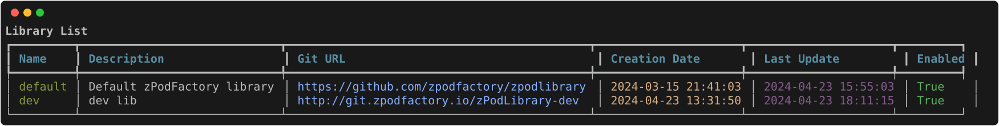
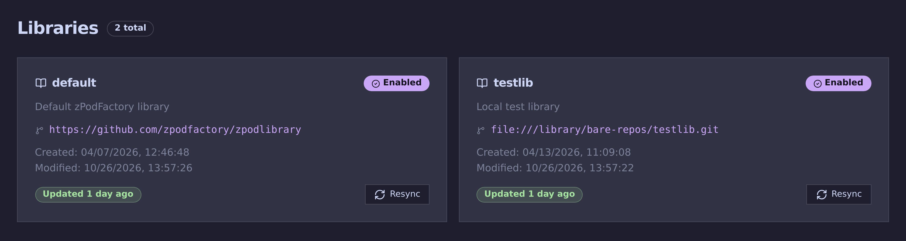
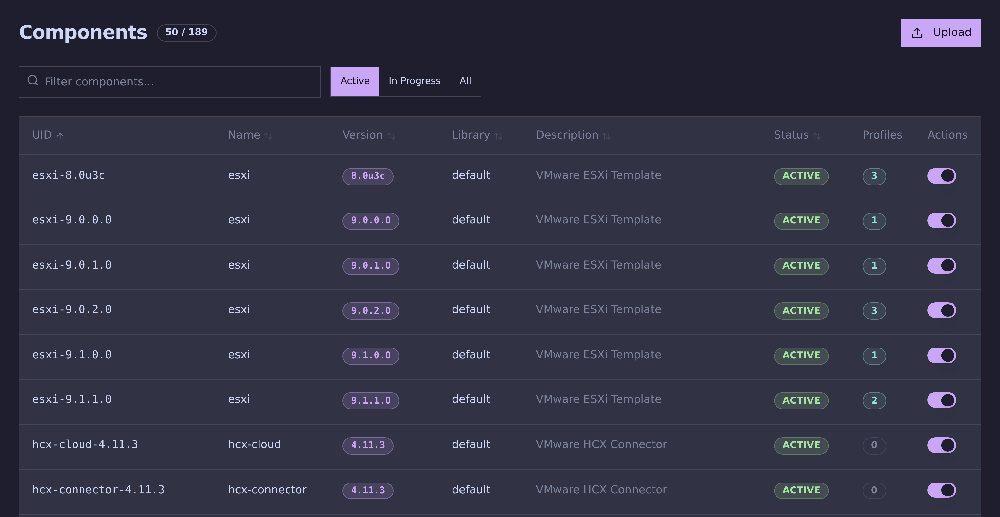
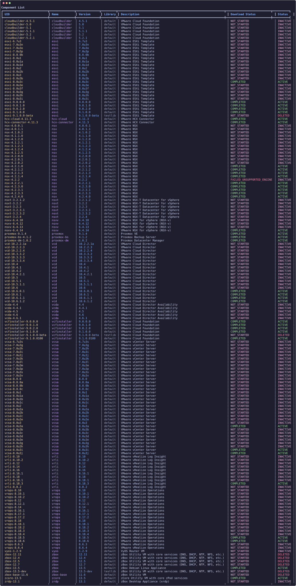
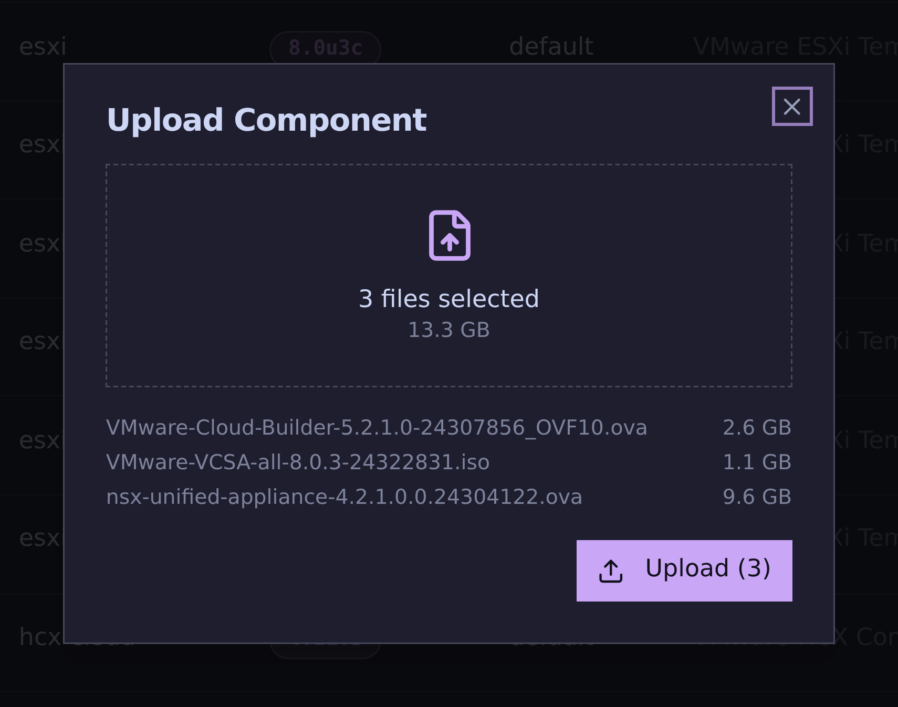
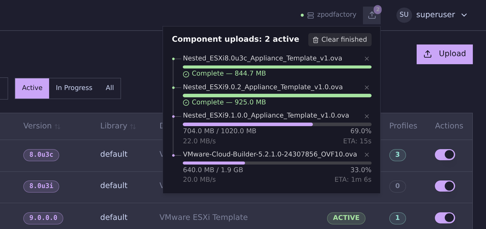

# Libraries & components

## Libraries

By default zPodFactory comes with a default library that contains all the "official" vmware and misc supported `components` supported by the framework.

This library is stored in a [git repository](https://github.com/zpodfactory/zpodlibrary) and is cloned locally, and used to fetch all `components` metadata (mainly the OVA binary files with some misc information) we use to manage the products.

Listing libraries:

``` {data-copy="zcli library list"}
❯ zcli library list
```



> PS: The `default` library is the only one available for now, but the framework is designed to be able to support multiple libraries.

In **zpodweb**, the **Libraries** page shows each library as a card, with its git repository, when it was last synced, and a **Resync** button:



Resync the library:

``` {data-copy="zcli library resync default"}
❯ zcli library resync default
```

> PS: The `resync` command will refresh all the `components` metadata from the git repository, and will update the local database with the new information.

## Components

Most administrators use the **Components** page in [zpodweb](../user/web-ui.md#components) — a searchable, filterable catalog where you can enable or disable components, watch download progress, and upload OVA/ISO files via file picker. The CLI commands below call the same zPod API.



Each row shows the component's version, library and status, how many profiles use it, and a toggle to enable or disable it. The **Active**, **In Progress** and **All** filters switch between components ready to deploy, downloads and uploads still running, and the whole catalog.

Enabling a component triggers the embedded download engine. Configure `zpodfactory_broadcom_download_token` first for VMware products from the Broadcom depot — set it under **Settings** in the Web UI, or via CLI (see [Broadcom download token](broadcom-download-token.md)). When depot download is not possible, use **Upload** in the Web UI or `zcli component upload` for manual OVA provisioning.

List all `components`:

``` {data-copy="zcli component list -a"}
❯ zcli component list -a
```



List all available components (ready to deploy):

``` {data-copy="zcli component list"}
❯ zcli component list
```


Enable a `component` (make it available for deployment):

In **zpodweb**, open **Components**, find the component, and click **Enable** — the same download flow runs as the CLI command below.

!!! info "Download engines"

    The download engine supports the **`https`** engine only (direct wget from URLs in the library). VMware product URLs use the Broadcom offline depot layout with a `${BROADCOM_DOWNLOAD_TOKEN}` placeholder substituted at runtime.

    Non-VMware components (such as `zcore`) may use direct HTTPS URLs. The upload feature remains available as a fallback — checksum verification matches the file against library metadata and enables the correct component automatically.

You will need to use the `component` UID (unique name of the `component`, as depicted in the list command above)

``` {data-copy="zcli component enable zcore-13.7"}
❯ zcli component enable zcore-13.7
```

Disable a component (removes the product file from disk):

``` {data-copy="zcli component disable vcsa-8.0u3i"}
❯ zcli component disable vcsa-8.0u3i
```

Upload a `component` to zPodFactory:

In **zpodweb**, use **Components → Upload** to select one or more OVA or ISO files from your workstation. The dialog lists every selected file with its size and the total, and uploads them all at once:



Uploads run in the background, so you can close the dialog and keep working. The upload button at the top right of the header counts the uploads still running; hover over it to see each file's progress, speed and time left. Each file is sent in 64 MB chunks, and an interrupted upload resumes where it stopped. A cross next to a running upload cancels it. Finished uploads turn green (red if they failed), and **Clear finished** empties them from the list:



Each file is checked against the library's checksums, and the matching component is enabled automatically.

``` {data-copy="zcli component upload /path/to/vmware-product.ova"}
❯ zcli component upload /tmp/VMware-Cloud-Builder-5.1.1.0-23480823_OVF10.ova
```

You can follow progress in **zpodweb** (Components list shows download percentage and status), with `zcli component list`, or inspect a specific component:

``` {data-copy="zcli component get vcsa-8.0u3i"}
❯ zcli component get vcsa-8.0u3i
```

JSON output is available on list/get commands with `-j` / `--json` for automation.

## Download engine

The download engine fetches component binaries defined in the [zPodLibrary](https://github.com/zPodFactory/zPodLibrary). See the dedicated [Broadcom download token](broadcom-download-token.md) guide for obtaining and configuring the token, troubleshooting 401/403 errors, and testing downloads.

### Quick reference

VMware product URLs use the Broadcom offline depot layout:

```
https://dl.broadcom.com/${BROADCOM_DOWNLOAD_TOKEN}/PROD/COMP/<TYPE>/<filename>
```

Configure your token:

```bash
zcli setting update zpodfactory_broadcom_download_token --value YOUR_TOKEN
```

Only the **`https`** download engine is supported. Use `zcli component upload` as a fallback when depot download is not available.

## Why is a product not available?

There can be multiple reasons for that:

- We just haven't added it yet (time)
    - This could also be because we are missing automation bits around it
    - This could also be because our download engine tooling can't fetch the product from VMware Customer Connect (there are some caveats on some specific Product sections)
- The product is not available on the Broadcom depot (check your portal entitlements and token)
- The library JSON still references a deprecated download engine (only `https` is supported)

!!! info

    Let us know which products you would like to be supported by zPodFactory and the download engine, and if you can provide any automation bits around it, that would be awesome.
