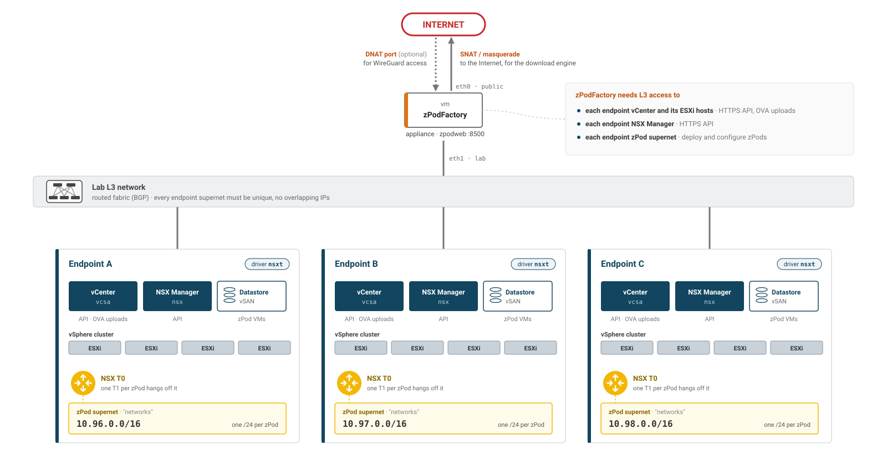
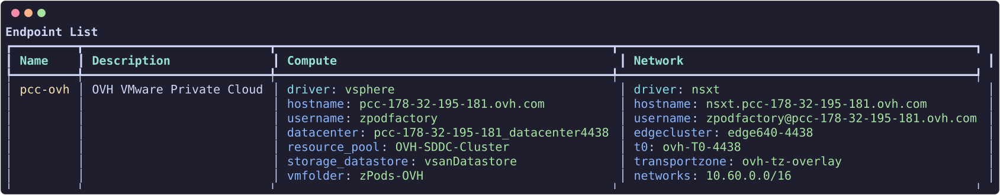

# Endpoints

Endpoints are the target physical environments a nested environment will be built upon.

The framework is designed to be able to support multiple endpoints, and to be able to deploy nested environments on different physical environments.

!!! warning

    Network connectivity from the zPodFactory Appliance to the following is **MANDATORY**:

    - VMware vCenter Server (HTTPS API)
    - VMware ESXi Hosts (OVF/OVA uploads)
    - VMware NSX-T Manager (HTTPS API)
    - VMware NSX-T `networks` supernet L3 connectivity



List all endpoints:

``` {data-copy="zcli endpoint list"}
❯ zcli endpoint list
```



Create an endpoint:

``` {data-copy="zcli endpoint add"}
❯ zcli endpoint create

 Usage: zcli endpoint create [OPTIONS] ENDPOINT_NAME

 Endpoint Create

╭─ Arguments ──────────────────────────────────────────────────────────╮
│ *    endpoint_name      TEXT  Endpoint name [required]               │
╰──────────────────────────────────────────────────────────────────────╯
╭─ Options ────────────────────────────────────────────────────────────╮
│ --description     -d       TEXT  Description                         │
│ --endpoints       -e       TEXT  Endpoints json                      │
│ --endpoints-file  -ef      PATH  File containing endpoints json      │
│ --help                           Show this message and exit.         │
╰──────────────────────────────────────────────────────────────────────╯

```

If you just want to create a simple endpoint, you can use the interactive command or generate a sample JSON file:

``` {data-copy="zcli endpoint create sddc-lab --generate-config-sample"}
❯ zcli endpoint create testendpoint --generate-config-sample
```

This writes `testendpoint-sample.json` that you can edit and pass back with `--endpoints-file`.

Interactive creation:

``` {data-copy="zcli endpoint create sddc-lab"}
❯ zcli endpoint create testendpoint

Compute Endpoint
driver [vsphere] (vsphere):
hostname: vcenter.fqdn.lab
username: zpodserviceuser@fqdn.lab
password: ********
datacenter: Datacenter-Paris
resource_pool: Cluster-SDDC
storage_datastore: vsanDatastore
vmfolder: zPods-Paris
vds: vds-Paris

Network Endpoint
driver [nsxt/nsxt_projects] (nsxt_projects):
hostname: nsx.fqdn.lab
username (admin):
password: ********
networks: 10.130.0.0/16
transportzone: default-tz-overlay
edgecluster: edgeclustername
t0: T0-Lab
Endpoint testendpoint has been created.

```

This will allow for interactive creation of an endpoint and prompt for all the required information.

!!! tip "Which network driver?"
    Use **`nsxt`**: it is the driver most deployments use and the recommended one. `nsxt_projects` adds extended capabilities, an NSX Project per zPod and shared projects through [ENets](#enets), but it has not been tested recently and is not recommended for new endpoints. See [NSX networking](../concepts.md#nsx-networking).

!!! info "Compute `vds` field"
    `vds` names the vSphere Distributed Switch backing the endpoint's portgroups. Set it when clusters on the same vCenter share an NSX-T overlay transport zone across **different** VDS's — otherwise `govc import.ova` can't tell apart the identically-named zPod segment portgroup created on each VDS. Leave it blank (default) for single-VDS environments; existing endpoints keep working unchanged until you set it. There is no dedicated `zcli endpoint update --vds` flag yet — set or change it via `PATCH /endpoints/{id}` with `{"endpoints": {"compute": {"vds": "<name>"}}}`, or by re-running `endpoint create --endpoints-file` with an updated sample.

Inspect or export an endpoint:

```bash
zcli endpoint info <endpoint_name>
zcli endpoint info <endpoint_name> -j    # JSON
zcli endpoint update <endpoint_name> ...
zcli endpoint delete <endpoint_name>
```

## ENets

ENets (endpoint networks) are superadmin-only constructs for advanced endpoint networking:

```bash
zcli enet list
zcli enet create <name> ...
zcli enet delete <name>
```
