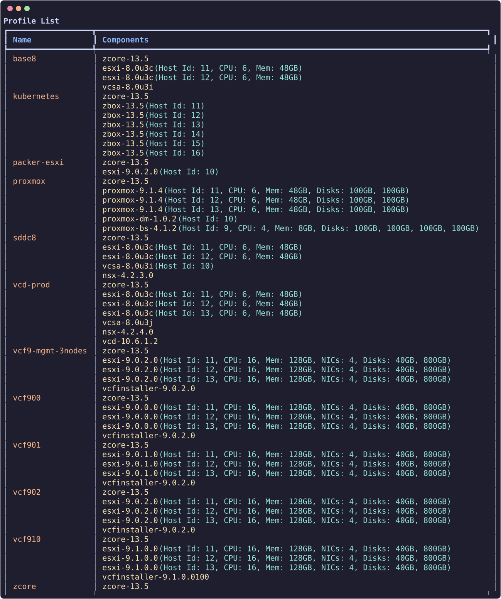

# Profiles

`Profiles` are a collection of `components` grouped together to form an initial nested environment.

They are the main entry point to deploy a nested environment and require a mandatory **`zcore-*`** core component as the **first** element (profiles that still start with the legacy `zbox-*` core must be migrated — see [zcore migration](zcore-migration.md)). The current `zbox` component, a Debian Linux appliance, is an ordinary component: it can appear anywhere after `zcore`, any number of times.

The core appliance (`zcore`) provides DNS/DHCP (dnsmasq), NFS storage for nested ESXi hosts, and routing for the three additional `/26` subnets on VLANs 64/128/192.

Profile entries support optional per-component overrides:

| Field | Applies to | Description |
| --- | --- | --- |
| `host_id` | esxi, etc. | Management subnet host ID |
| `hostname` | esxi, etc. | Short hostname |
| `vcpu`, `vmem` | esxi, proxmox, etc. | Sizing overrides |
| `vnics` | esxi, etc. | vNIC count (integer, e.g. `4`) |
| `vdisks` | esxi | Extra virtual disk sizes in GB (array of integers, e.g. `[40, 800]`) |
| `nested` | most components | `true`: nested in the zPod's vCenter, `false`: on the endpoint. Left out, the library entry decides. |
| `vlan_id` | esxi | Puts the host on the zPod network with that VLAN, its management interface tagged (e.g. `64`) |
| `network` | nested components | `portgroup`, `ip`, `gateway`, `dns`, all optional (e.g. `{"portgroup": "wld01"}`) |

`nested`, `vlan_id` and `network` need zpodcore 0.9.2 or later and follow the same rules as on a component add: see [Placement and network](../user/components.md#placement-and-network). A nested component deploys into the zPod's vCenter, so put it after the `vcsa` item. When a profile is saved, `host_id` is checked against the deploy network it lands on (mgmt, or VLAN 64, 128 or 192), and a profile that breaks a rule is refused with the reason.

For example, a fifth ESXi host on VLAN 64, and an Ubuntu VM nested in the zPod:

```json
{
  "component_uid": "esxi-8.0u3i",
  "host_id": 71,
  "hostname": "esxi71",
  "vlan_id": 64
},
{
  "component_uid": "ubuntu-24.04",
  "host_id": 20,
  "hostname": "web01",
  "nested": true
}
```

``` {data-copy="zcli profile list"}
❯ zcli profile list
```

Use `-j` for JSON output (used by `just zcore-transition` and automation):

```bash
zcli profile info <name> -j
zcli profile create <name> -pf profile.json
zcli profile update <name> -pf profile.json
zcli profile delete <name>
```



## Create a profile

Profiles can be created by an admin user, using the zPod API directly or the zPod CLI (`zcli`)

Prepare a `profile.json` file with the content of the `profile`, here is an example.

!!! info

    **`zcore-*`** component and **`esxi`** components are mandatory; all other components are optional.

    To find which components are available, check the `zcli component list` command, or check the zPodFactory [library](https://github.com/zPodFactory/zPodLibrary).

    Usually you want at least a `zcore`, a few `esxi` hosts and a `vcsa` or VCF profile as the base for any work/testing.

``` json
[
    {
      "component_uid": "zcore-13.7"
    },
    [
      {
        "component_uid": "esxi-8.0u3i",
        "host_id": 11,
        "hostname": "esxi11",
        "vcpu": 8,
        "vmem": 64
      },
      {
        "component_uid": "esxi-8.0u3i",
        "host_id": 12,
        "hostname": "esxi12",
        "vcpu": 8,
        "vmem": 64
      },
      {
        "component_uid": "esxi-8.0u3i",
        "host_id": 13,
        "hostname": "esxi13",
        "vcpu": 8,
        "vmem": 64
      },
      {
        "component_uid": "esxi-8.0u3i",
        "host_id": 14,
        "hostname": "esxi14",
        "vcpu": 8,
        "vmem": 64
      }
    ],
    {
        "component_uid": "vcsa-8.0u3i"
    },
    {
        "component_uid": "vcd-10.6.1"
    },
    {
        "component_uid": "nsx-4.2.1.3"
    }
]
```

Next use zcli to create the profile:

``` { data-copy="zcli profile create sddc-vcd -pf profile.json" }
❯ zcli profile create sddc-vcd -pf profile.json
Profile sddc-vcd has been created.
```

It then appears in `zcli profile list`, and in the **Profiles** page of the Web UI.
