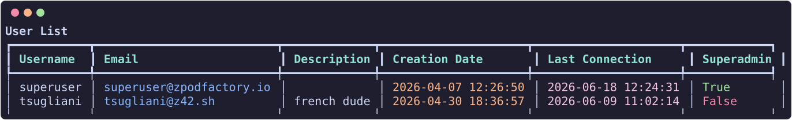

# Users, groups & permissions

## Users

Users, groups and endpoint access can also be managed from the **Users** and **Groups** pages and the endpoint **Access** section in [zpodweb](../user/web-ui.md#users-groups-and-endpoint-access).

List users:

``` {data-copy="zcli user list"}
❯ zcli user list
```



`user list` includes an **API Token** column: superadmins see every user's token, a user sees their own, and every other row is masked (`—`). Add `-j`/`--json` for machine-readable output (combine with `--no-color` to strip Rich styling), e.g. `zcli user list --json --no-color`.

Create, update, enable/disable, or reset API tokens:

```bash
zcli user add <username> --email user@example.com
zcli user update <username> --email new@example.com
zcli user enable <username>
zcli user disable <username>
zcli user reset_api_token <username>
```

Use `zcli user list --all` to include disabled users.

## Groups

Permission groups bundle users for zPod and endpoint access:

```bash
zcli group list
zcli group create <name> -d "Description"
zcli group update <name> -d "New description"
zcli group delete <name>
zcli group user add <group> <username>
zcli group user remove <group> <username>
```

## Permissions

zPodFactory supports RBAC on zPods and endpoints with three permission levels:

| Level | Capabilities |
| --- | --- |
| `OWNER` | Full control including destroy and permission management |
| `ADMIN` | Maintain zPod (components, DNS, permissions); superadmins receive a virtual `ADMIN` on all zPods |
| `USER` | Read access (components, DNS, networks) |

### zPod permissions

```bash
zcli zpod permission list <zpod_name>
zcli zpod permission add <zpod_name> --user alice --permission OWNER
zcli zpod permission add <zpod_name> --group lab-admins --permission USER
zcli zpod permission remove <zpod_name> --user alice --permission OWNER
```

!!! warning "Last maintainer guard"
    You cannot remove the last `OWNER`/`ADMIN` from a zPod — doing so would orphan it. Reassign ownership first, or use a superadmin account.

The API also exposes `GET /zpods/{id}/permissions/mine` for UIs to discover the caller's effective permission level.

### Endpoint permissions

```bash
zcli endpoint permission list <endpoint_name>
zcli endpoint permission add <endpoint_name> --user alice --permission OWNER
zcli endpoint permission remove <endpoint_name> --group lab-admins --permission USER
```
