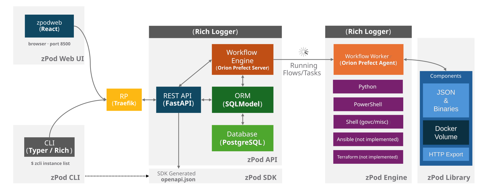
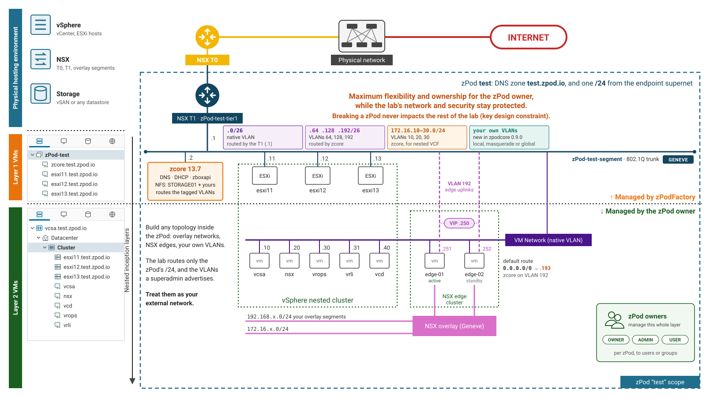
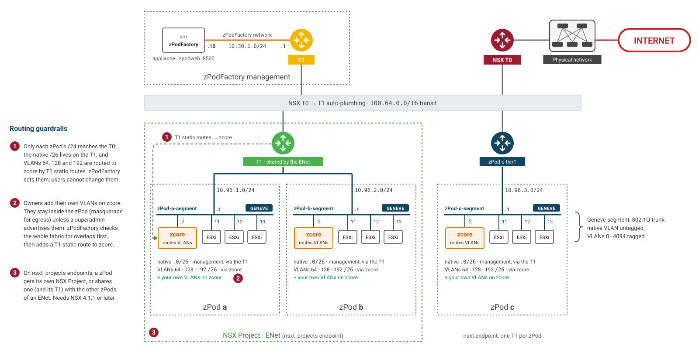
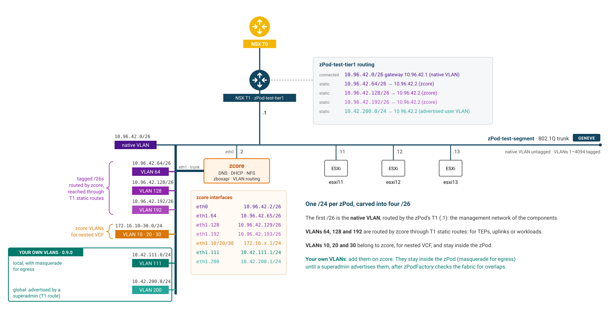
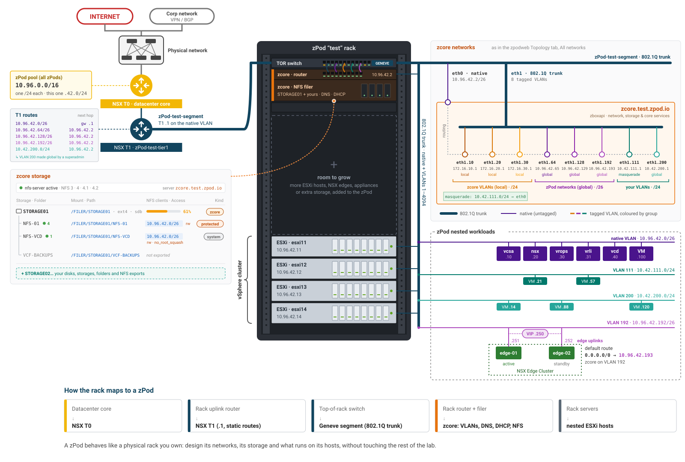

# Concepts & architecture

This page explains the moving parts of zPodFactory and how a zPod is laid out, so the rest of the documentation reads easily.

## Glossary

| Term | What it is |
| --- | --- |
| **zPod** | One nested environment: a set of VMs (the components) on its own `/24` network, with its own DNS zone `<zPod name>.<default domain>`. |
| **Endpoint** | Where zPods are deployed: a vCenter and NSX pair, plus the supernet zPod networks are carved from. See [Endpoints](admin/endpoints.md). |
| **Component** | A product zPodFactory can deploy (ESXi, vCenter, NSX, zcore, …), defined by the library and enabled by an administrator. See [Libraries & components](admin/components.md). |
| **Library** | A git repository of component definitions, by default [zPodLibrary](https://github.com/zPodFactory/zPodLibrary). |
| **Profile** | A list of components deployed together to create a zPod, always starting with `zcore`. See [Profiles](admin/profiles.md). |
| **zcore** | The mandatory core appliance of every zPod: DNS and DHCP, the NFS filer, routing of the VLAN networks, and `zboxapi`, the API zPodFactory drives it through. Older zPods may still run the legacy `zbox` core. |
| **zbox** | An ordinary Debian Linux appliance component (`zbox-13.5`, `zbox-13.7` soon) that you can add to a zPod, several times if needed, for example as a Docker or Kubernetes host. Not to be confused with the legacy `zbox` core. See [zcore migration](admin/zcore-migration.md). |
| **zPod API / zPod Engine** | The REST API every client talks to, and the Prefect flows that do the deployment work behind it. |
| **zcli / zpodweb** | The command line and the Web UI. Both use the zPod API. |

## Architecture

zPodFactory is built upon the following various opensource projects:

The project is composed of the following sub-projects:

- **zPod API**: The zPod API is the core component of the project. It's the main entry point to interact with the project. It's a REST API that exposes the main functionalities of the project. It's the only component that is publicly exposed. It is the central component that controls and orchestrates everything in this framework. It will take care of any requests, manage and store information, and orchestrate/schedule flows onto the **zPod Engine** for execution.

- **zPod SDK**: The zPod SDK is generated from the [FastAPI](https://fastapi.tiangolo.com/) OpenAPI JSON schema. It's a Python SDK that allows clients to interact with the API without using pure REST API calls.
- **zPod CLI**: The zPod CLI is a wrapper around the zPod API which is used to manage, configure and operate everything required to run zPods. It is based on the [Typer](https://typer.tiangolo.com/) framework.
- **zpodweb**: The official [Web UI](https://github.com/zPodFactory/zpodweb) for zPodFactory. Deployed automatically with the appliance on port **8500**, it provides dashboards, zPod management, network topology diagrams, and visual administration of components, profiles, endpoints, and settings. See the [Web UI guide](user/web-ui.md).
- **zPod Engine**: The zPod Engine is the core component responsible for the deployment of the nested environment. It uses the [Prefect](https://docs.prefect.io/) workflow orchestration engine to handle scheduling and execution of all flows and their child tasks.
- **zPod Library**: This is a storage location that encompasses the [zPodLibrary](https://github.com/zPodFactory/zPodLibrary) component metadata and downloaded templates/binaries.  These files will be managed by the embedded download engine.

> Everything runs in Docker containers, through a Docker Compose application stack.

## Layers

A zPod is built in layers, nested inside each other:

- **Physical hosting environment** (blue): the vSphere, NSX and storage zPods are deployed on, an [endpoint](admin/endpoints.md). Each zPod gets its own NSX T1, connected to the endpoint's T0, and an overlay segment that trunks every VLAN.
- **Layer 1 VMs** (orange), managed by zPodFactory: the VMs it deploys on the endpoint, in a vApp named after the zPod. **zcore** (`.2`) is the zPod's core appliance: DNS and DHCP, the NFS filer for the nested hosts, routing of the tagged VLANs, and `zboxapi`. The **ESXi** hosts (`.11` and up) are the nested hypervisors.
- **Layer 2 VMs** (green), managed by the zPod owner: what runs on the nested hosts, usually a nested vCenter (`.10`) with NSX, VCD, Aria and so on, plus anything the owner builds: overlay networks, edges, their own VMs.

The zPod owner has full control inside their zPod, since its password is the admin password of every component, while the zPod's networking keeps each zPod isolated from the others and from the physical environment. Breaking a zPod never affects the rest of the lab.

## NSX networking

Every zPod gets its own **NSX T1**, connected to the endpoint's T0, and its own **Geneve segment**, an 802.1Q trunk carrying the native VLAN untagged and VLANs 0–4094 tagged. The zPodFactory appliance sits on its own management network.

How the T1 is laid out depends on the endpoint's network driver:

- **`nsxt`** (recommended): one T1 per zPod, named after it, such as `zPod-c-tier1` (zPod `c` in the diagram). This is the driver most deployments use.
- **`nsxt_projects`**: extended capabilities on top of `nsxt`. Each zPod gets its own **NSX Project**, for multi-tenancy, and zPods attached to an [ENet](admin/endpoints.md#enets) share one project and its T1, each with its own segment (zPods `a` and `b`). Projects need NSX 4.1.1 or later. This driver has not been tested recently, so it is not recommended for new endpoints.

Routing is kept under control by three guardrails, numbered in the diagram:

1. Only each zPod's `/24` reaches the T0: the native `/26` lives on the T1, and VLANs 64, 128 and 192 are routed to zcore by T1 static routes. zPodFactory sets them; users cannot change them.
2. zPod owners add their own VLANs on zcore. They stay inside the zPod (with masquerade for egress) unless a superadmin advertises them: zPodFactory checks the whole fabric for overlaps first, then adds a T1 static route to zcore. See [Networks](user/networks.md).
3. On `nsxt_projects` endpoints, the project boundary isolates each zPod, or each ENet, from the others.

## zPod networks

Each zPod gets one `/24` from the endpoint's supernet, carved into four `/26` networks. For a zPod `test` with `10.96.42.0/24`:

| Network | VLAN | Routed by |
| --- | --- | --- |
| `10.96.42.0/26` | native (untagged): the management network of the components | the zPod's NSX T1 |
| `10.96.42.64/26` | 64 (tagged) | `zcore` |
| `10.96.42.128/26` | 128 (tagged) | `zcore` |
| `10.96.42.192/26` | 192 (tagged) | `zcore` |

All four are advertised upstream through the T0. The tagged VLANs make it easy to put nested host TEPs, edge TEPs or uplinks on separate networks. zcore also carries VLANs 10, 20 and 30 (`172.16.10/20/30.0/24`) for nested VCF.

Beyond these, a zPod owner can add their own VLAN networks on zcore, optionally with egress, and a superadmin can advertise them to the NSX fabric. See [Networks](user/networks.md).

## A zPod as a physical rack

A zPod behaves like a physical rack you own, which makes it a good place to design, test or learn a datacenter architecture:

| In a physical rack | In a zPod |
| --- | --- |
| Datacenter core | the endpoint's NSX T0 |
| Rack uplink router | the zPod's NSX T1, gateway `.1` of the native VLAN, with static routes to zcore |
| Top-of-rack switch | the zPod's Geneve segment, an 802.1Q trunk carrying the native VLAN and VLANs 1–4094 |
| Rack router and filer | zcore: routing of the tagged VLANs, DNS, DHCP and the NFS filer |
| Rack servers | the nested ESXi hosts |

What runs on the hosts, how the VLANs are used, and which storage is added is up to the zPod owner, without touching the rest of the lab.
