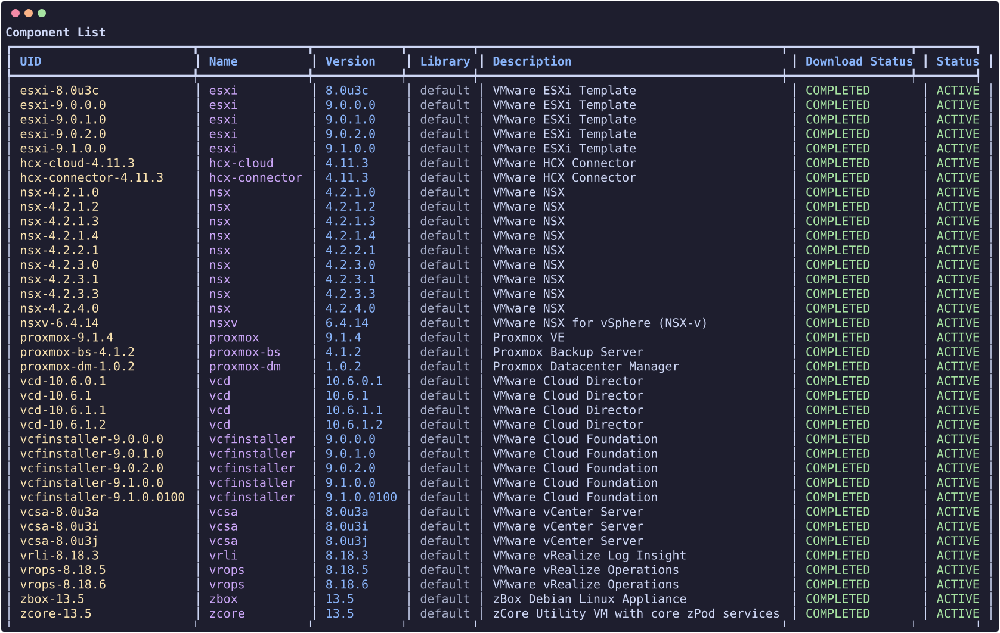
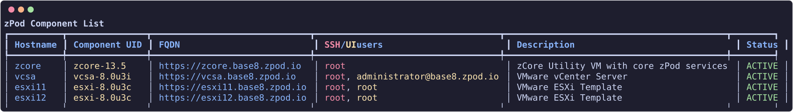

# Components

In [zPods](zpods.md#create-zpods) we deployed a zPod with the `base` profile, which does not contain many products, but only the bare minimum to have a functional nested environment.
Here we will show you how to list the available components, and add a new component to a deployed/available zPod.

## List components

``` {data-copy="zcli component list"}
❯ zcli component list
```




## List components of a zPod

You will need to provide the zpod name parameter so that the CLI knows which zPod to list the components from.

``` {data-copy="zcli zpod component list zpod_name"}
❯ zcli zpod component list zpod_name
```



## Add components to a zPod

Provide the `component_uid` (use `zcli component list`). Optional overrides match [profile](../admin/profiles.md) fields — useful for ESXi hosts that need custom sizing:

| Flag | Type | Example |
| --- | --- | --- |
| `--host-id` | integer | `13` |
| `--hostname` | string | `esxi13` |
| `--vcpu`, `--vmem` | integer | `16`, `128` |
| `--vnics` | integer | `4` (vNIC **count**, not a JSON object) |
| `--vdisks` | integer (repeatable) | `--vdisks 40 --vdisks 800` → disks of 40 GB and 800 GB |

Example aligned with a VCF-style profile entry (see `zcli profile info vcf-902-3hosts`):

```bash
zcli zpod component add <zpod_name> -c esxi-9.0.2.0 \
  --host-id 13 --hostname esxi13 \
  --vcpu 16 --vmem 128 \
  --vnics 4 \
  --vdisks 40 --vdisks 800
```

In profile JSON the same host would look like:

```json
{
  "component_uid": "esxi-9.0.2.0",
  "host_id": 13,
  "hostname": "esxi13",
  "vcpu": 16,
  "vmem": 128,
  "vnics": 4,
  "vdisks": [40, 800]
}
```

Example:

``` {data-copy="zcli zpod component add team.beta -c vcd-10.6.1"}
❯ zcli zpod component add team.beta -c vcd-10.6.1
```

Supported component families include VMware products (vSphere, NSX, VCF, HCX, etc.) and **Proxmox** (`proxmox`, `proxmox-dm`, `proxmox-bs`).
