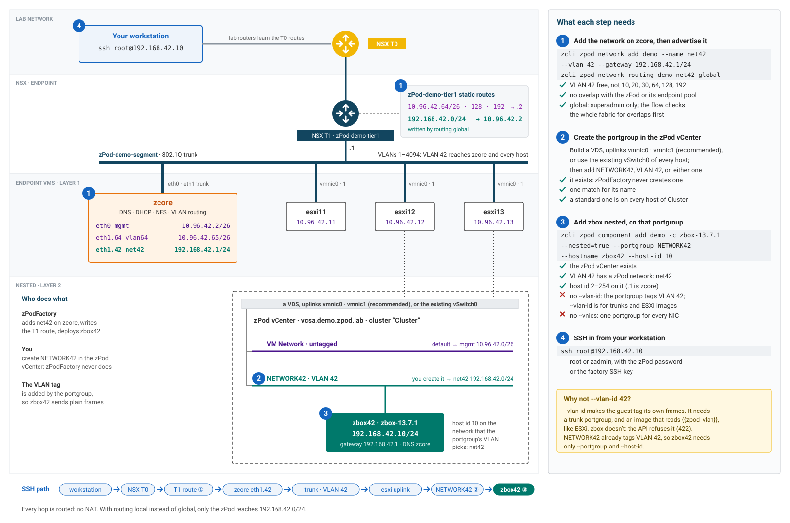
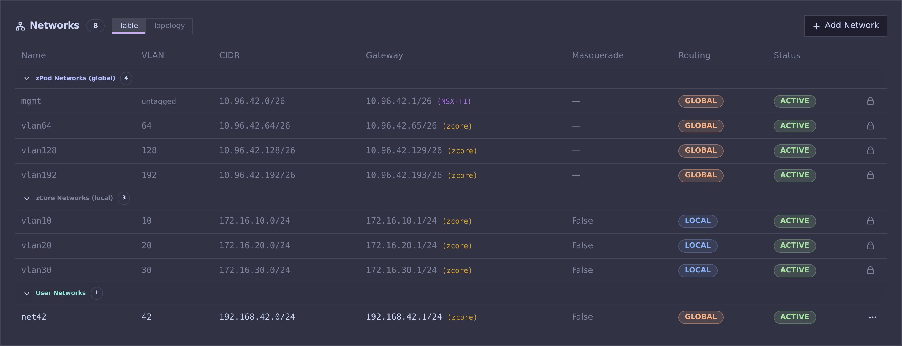

# Components

In [zPods](zpods.md#create-zpods) we deployed a zPod with the `base` profile, which does not contain many products, but only the bare minimum to have a functional nested environment.
Here we will show you how to list the available components, and add a new component to a deployed/available zPod.

## List components

``` {data-copy="zcli component list"}
❯ zcli component list
```


## List components of a zPod

You will need to provide the zpod name parameter so that the CLI knows which zPod to list the components from.

``` {data-copy="zcli zpod component list zpod_name"}
❯ zcli zpod component list zpod_name
```


## What you can add

The [zPodLibrary](https://github.com/zPodFactory/zPodLibrary) groups components into families. A component's uid is its family and version, such as `esxi-8.0u3i` or `zbox-13.7.1`; `zcli component list` shows the ones enabled on your factory. **Default placement** is where a component deploys unless you set `--nested` ([placement and network](#placement-and-network)). Families marked *fixed* have their own deploy path and keep that placement.

| Family | Components | Default placement |
| --- | --- | --- |
| Core | `zcore` (every zPod's first component), `vyos` | on the endpoint (`zcore`, fixed), nested (`vyos`, fixed) |
| vSphere | `esxi`, `vcsa` | on the endpoint (`esxi`, fixed), nested (`vcsa`, fixed) |
| VMware Cloud Foundation | `vcfinstaller` (VCF 9), `cloudbuilder` (VCF 5 and earlier) | on the endpoint, fixed |
| NSX | `nsx`, `nsxt`, `nsxv` | nested |
| Cloud Director | `vcd`, `vcda` | nested |
| HCX | `hcx-cloud`, `hcx-connector` | nested |
| Operations | `vrops`, `vrli` | nested |
| Proxmox | `proxmox` (VE), `proxmox-dm` (Datacenter Manager), `proxmox-bs` (Backup Server) | on the endpoint, fixed |
| Linux and tools | `zbox` (Debian appliance), `zrdp` (desktop over xrdp) | on the endpoint (`zbox`), nested (`zrdp`) |
| Cloud images | `ubuntu`, `photon`, `rhcos`, `talos`: stock images configured on first boot ([details](../admin/components.md#stock-cloud-images)) | on the endpoint |

Administrators enable components and manage the library: see [Libraries & components](../admin/components.md).

## Add components to a zPod

Provide the `component_uid` (use `zcli component list`). Optional overrides match [profile](../admin/profiles.md) fields — useful for ESXi hosts that need custom sizing:

| Flag | Type | Example |
| --- | --- | --- |
| `--host-id` | integer | `13` |
| `--hostname` | string | `esxi13` |
| `--vcpu`, `--vmem` | integer | `16`, `128` |
| `--vnics` | integer | `4` (vNIC **count**, not a JSON object) |
| `--vdisks` | integer (repeatable) | `--vdisks 40 --vdisks 800` → disks of 40 GB and 800 GB |
| `--nested` | `true` or `false` | `true`: nested in the zPod's vCenter; `false`: on the endpoint ([placement](#placement-and-network)) |
| `--vlan-id` | integer | `64`: the zPod network on VLAN 64, interface tagged (ESXi) |
| `--portgroup`, `--ip`, `--gateway`, `--dns` | string | Network of a nested component: `wld01`, `192.168.50.10/24`, … |

Example aligned with a VCF-style profile entry (see `zcli profile info vcf-902-3hosts`):

```bash
zcli zpod component add <zpod_name> -c esxi-9.0.2.0 \
  --host-id 13 --hostname esxi13 \
  --vcpu 16 --vmem 128 \
  --vnics 4 \
  --vdisks 40 --vdisks 800
```

In profile JSON the same host would look like:

```json
{
  "component_uid": "esxi-9.0.2.0",
  "host_id": 13,
  "hostname": "esxi13",
  "vcpu": 16,
  "vmem": 128,
  "vnics": 4,
  "vdisks": [40, 800]
}
```

Example:

``` {data-copy="zcli zpod component add team.beta -c vcd-10.6.1"}
❯ zcli zpod component add team.beta -c vcd-10.6.1
```

## Placement and network

!!! info
    zpodcore **0.9.2** or later. In the Web UI, the **Add component** dialog and the profile editor have the same options in a folded **Placement & network** section.

By default, a component is deployed where its library entry says (nested in the zPod's vCenter, or on the endpoint next to zcore), on the zPod's management network, with the address `host_id` gives it. A component add or a [profile](../admin/profiles.md) item can change that. With none of these options, components deploy exactly as before.

Where the component lands decides which options apply and where its address comes from:

| Placement | Portgroup | Address | Example |
| --- | --- | --- | --- |
| On the endpoint (default for `esxi`, `zcore`, `zbox` and the cloud images) | the zPod segment (a trunk) | `host_id` on the management network | `10.96.42.20` |
| On the endpoint, with `--vlan-id` (ESXi) | the zPod segment; the guest tags its own frames | `host_id` on the zPod network with that VLAN | `--vlan-id 64 --host-id 71` → `10.96.42.71` |
| Nested (default for `vcsa`, NSX, VCD and most VMware appliances) | `VM Network`, untagged | `host_id` on the management network | `10.96.42.20` |
| Nested, with `--portgroup` | a portgroup you created, on VLAN N | `host_id` on the zPod network with VLAN N | VLAN 42 → `192.168.42.10` |
| Nested, with `--portgroup` and `--vlan-id` | a trunk portgroup; the guest tags its own frames | `host_id` on the zPod network with that VLAN | ESXi images only |
| Nested, with `--ip` | any portgroup | the address you give, with `--gateway` outside the zPod's networks | `192.168.50.10/24` |

[A worked example](#example-a-zbox-on-its-own-vlan) below goes through every layer, from the zcore network to an SSH session.

### Nested or on the endpoint

`--nested=true` deploys the component nested in the zPod's vCenter, `--nested=false` on the endpoint. Use it to run a lightweight VM inside the zPod, or to move a heavy appliance out of the nested hosts:

``` {data-copy="zcli zpod component add zpod_name -c ubuntu-24.04 --nested=true --hostname web01 --host-id 20"}
❯ zcli zpod component add zpod_name -c ubuntu-24.04 --nested=true --hostname web01 --host-id 20
```

- A nested deploy needs the zPod's vCenter to exist already. A deploy on the endpoint checks the endpoint's datastore floor first.
- Components with their own deploy path (`zcore`, `vyos`, `vcsa`, `esxi`, `proxmox`, `proxmox-dm`, `proxmox-bs`, `cloudbuilder`, `vcfinstaller`) keep their placement: `vcsa` is always nested, `esxi` always on the endpoint. The API refuses a change.
- `--vnics` is refused on a nested component: all its NICs share one portgroup.

### Network of a nested component

A nested component can go on another portgroup of the zPod's vCenter, and take its own address, gateway and DNS server. Every option is optional; the zPod's defaults fill the rest.

| Option | Default | Meaning |
| --- | --- | --- |
| `--portgroup` | `VM Network` | An existing portgroup of the zPod's vCenter, by name or inventory path. zPodFactory never creates one. Every NIC of the VM goes on it. |
| `--ip` | `host_id` on the portgroup's network | An address with its prefix, for a subnet no zPod network gives, such as an isolated lab. |
| `--gateway` | the zPod network's gateway | Required with an `--ip` outside every zPod network. |
| `--dns` | zcore | The DNS server the guest uses. |

The portgroup's VLAN picks the zPod network the address comes from: an untagged portgroup gives an address on the management network, a portgroup on VLAN N one on the zPod network on VLAN N, so the address always matches the wire. For example, with the [user network](networks.md) `wld01` (VLAN 1000, `10.42.111.0/24`) and a nested portgroup `wld01` on VLAN 1000:

``` {data-copy="zcli zpod component add zpod_name -c ubuntu-24.04 --nested=true --hostname app01 --host-id 20 --portgroup wld01"}
❯ zcli zpod component add zpod_name -c ubuntu-24.04 --nested=true --hostname app01 --host-id 20 --portgroup wld01
```

The VM gets `10.42.111.20/24`, with zcore (`10.42.111.1`) as its gateway.

The API refuses, before anything is deployed, a portgroup that is missing or ambiguous, a standard portgroup absent from some of the cluster's hosts, a trunk without `--vlan-id`, a VLAN with no zPod network, and `--portgroup`, `--ip`, `--gateway` or `--dns` on a component deployed on the endpoint.

### ESXi on a tagged zPod network

`--vlan-id` puts a component on the zPod network with that VLAN, and tells the guest to tag its own interface. ESXi uses it for its management interface:

``` {data-copy="zcli zpod component add zpod_name -c esxi-8.0u3i --hostname esxi71 --host-id 71 --vlan-id 64"}
❯ zcli zpod component add zpod_name -c esxi-8.0u3i --hostname esxi71 --host-id 71 --vlan-id 64
```

The host gets `10.96.42.71` on VLAN 64, with that network's mask and gateway. Since the guest tags its frames, its portgroup must be a trunk: on the endpoint, the zPod segment already is (VLAN 0-4094); a nested component takes `--vlan-id` with `--portgroup` set to a trunk portgroup (`--gateway` and `--dns` combine with it, `--ip` doesn't).

Only components whose library entry uses the `{{zpod_vlan}}` deploy variable accept `--vlan-id`: the zPodLibrary ESXi entries do.

### Host IDs on a tagged network

`host_id` is always the last octet in the `/24` that holds the network. The deploy networks keep the zPod's `/24` numbering, so with the zPod `10.96.42.0/24`:

| Network | Host IDs |
| --- | --- |
| mgmt (untagged) | `2` to `62` |
| VLAN 64 | `66` to `126` |
| VLAN 128 | `130` to `190` |
| VLAN 192 | `194` to `254` |

A `host_id` outside its network is refused, and the error names the range that fits. Profiles are checked against the deploy networks when they are saved; user networks are checked at deploy.

### Example: a zbox on its own VLAN

This example gives a nested `zbox` its own VLAN and subnet, and reaches it over SSH from a workstation, by its own IP. The zPod is `demo`, its domain `demo.zpod.lab`, its vCenter `vcsa.demo.zpod.lab`, and the new network is `192.168.42.0/24` on VLAN 42.

[](../../img/zPodFactory-component-placement-network42.svg)

The four steps happen on four different layers:

1. zcore and NSX: add the network on zcore, then advertise it to the fabric.
2. The zPod's vCenter: create a portgroup on VLAN 42.
3. zPodFactory: deploy the zbox nested, on that portgroup.
4. Your workstation: SSH to the zbox.

**1. Add the network on zcore, and advertise it**

zcore takes `192.168.42.1` on VLAN 42 and routes the subnet. See [Networks](networks.md#add-a-network) for every option and check:

``` {data-copy="zcli zpod network add demo --name net42 --vlan 42 --gateway 192.168.42.1/24"}
❯ zcli zpod network add demo --name net42 --vlan 42 --gateway 192.168.42.1/24
```

The network is `local`: only the zPod reaches it. To reach the zbox from your workstation by its own IP, a superadmin advertises the network to the fabric. The flow checks the whole fabric for overlaps, then writes a T1 static route to `192.168.42.0/24` through zcore (`10.96.42.2`). Run it with `--dry-run` first, as described in [Routing](networks.md#routing-advertise-to-the-fabric):

``` {data-copy="zcli zpod network routing demo net42 global"}
❯ zcli zpod network routing demo net42 global
```

If the network should stay inside the zPod, skip this and turn on `--masquerade` instead: the zbox then reaches out, but only machines inside the zPod reach it.

**2. Create the portgroup in the zPod's vCenter**

zPodFactory never creates portgroups: you create `NETWORK42`, on VLAN 42, in the zPod's vCenter. The nested hosts' uplinks (`vmnic0`, `vmnic1`, …) sit on the zPod's trunk segment, so VLAN 42 already reaches every host. Log in to `https://vcsa.demo.zpod.lab` as `administrator@demo.zpod.lab` with the zPod password, pick a switch, then add the portgroup on it.

=== "VDS (recommended)"

    Build a distributed switch with the hosts' uplinks, `vmnic0` and `vmnic1`, then add one distributed port group: vCenter keeps it identical on every host.

    In the vSphere Client: **Networking**, right-click the datacenter, **Distributed Switch > New Distributed Switch**, then **Add and Manage Hosts** to add every host of the cluster with their uplinks. Then **Distributed Port Group > New Distributed Port Group** on the switch: name `NETWORK42`, VLAN type **VLAN**, VLAN ID `42`.

    Or with `govc` (here with `vmnic1` as the uplink, which leaves `vmnic0` and the hosts' management on `vSwitch0`):

    ```bash
    export GOVC_URL=vcsa.demo.zpod.lab GOVC_USERNAME=administrator@demo.zpod.lab GOVC_PASSWORD='<zPod password>' GOVC_INSECURE=1
    govc dvs.create DSwitch
    for host in $(govc find / -type h); do
      govc dvs.add -dvs DSwitch -pnic vmnic1 "$host"
    done
    govc dvs.portgroup.add -dvs DSwitch -vlan 42 NETWORK42
    ```

=== "Existing vSwitch0"

    Add a standard port group to `vSwitch0`, which every host already has. It works, but is usually not recommended: the port group is per host, so it must be created on **every** host of the cluster, or the API refuses it, and kept identical by hand.

    In the vSphere Client, on each host: **Configure > Networking > Virtual switches**, then **Add Networking** on `vSwitch0`: **Virtual Machine Port Group for a Standard Switch**, network label `NETWORK42`, VLAN ID `42`.

    Or with `govc`, for every host of the cluster at once:

    ```bash
    export GOVC_URL=vcsa.demo.zpod.lab GOVC_USERNAME=administrator@demo.zpod.lab GOVC_PASSWORD='<zPod password>' GOVC_INSECURE=1
    for host in $(govc find / -type h); do
      govc host.portgroup.add -host "$host" -vswitch vSwitch0 -vlan 42 NETWORK42
    done
    ```

Either way, the name must match one network only: `--portgroup` also takes a distributed port group's inventory path (`/<datacenter>/network/DSwitch/NETWORK42`) when the name is ambiguous.

**3. Deploy the zbox, nested, on that portgroup**

``` {data-copy="zcli zpod component add demo -c zbox-13.7.1 --nested=true --portgroup NETWORK42 --hostname zbox42 --host-id 10"}
❯ zcli zpod component add demo -c zbox-13.7.1 --nested=true --portgroup NETWORK42 --hostname zbox42 --host-id 10
```

- `--nested=true` deploys it in the zPod's vCenter: `zbox` deploys on the endpoint by default.
- `--portgroup NETWORK42` puts its NIC on VLAN 42. zPodFactory reads the portgroup's VLAN in the vCenter, finds `net42` on that VLAN, and gives the zbox `192.168.42.10/24` (`--host-id 10`), with zcore (`192.168.42.1`) as gateway and DNS.
- `--host-id` must fit the network: `2` to `254` here, since `.1` is zcore.

!!! question "Why not `--vlan-id 42`?"
    `--vlan-id` asks the guest to tag its own frames. It needs a trunk portgroup, and an image that reads the `{{zpod_vlan}}` deploy variable, like ESXi. The zbox image doesn't, so the API refuses `--vlan-id` for it (`422`). `NETWORK42` already tags VLAN 42, so the zbox needs only `--portgroup` and `--host-id`.

The deploy runs as a zPod Engine flow; follow it with `zcli zpod component list demo` until the zbox is `ACTIVE`.

**4. SSH to the zbox**

`zcli zpod component list demo` shows the zbox's address and login users, `root` and `zadmin`. Both take the zPod password, and the factory's SSH key is installed:

``` {data-copy="ssh root@192.168.42.10"}
❯ ssh root@192.168.42.10
```

The connection goes from your workstation to the NSX T0, through the T1 static route to zcore, then on VLAN 42 down the trunk to an ESXi uplink, `NETWORK42`, and the zbox. No address is translated on the way. Your workstation reaches it if the lab's routers learn the T0's routes, as they already do for the zPod's own subnets.

### What it looks like in zpodweb

The zPod detail page in [zpodweb](web-ui.md) draws where each component landed. Here is the `demo` zPod at the end of the example, with two more ESXi hosts on tagged deploy networks:

| Component | Network | Address |
| --- | --- | --- |
| `vcsa`, `esxi11`, `esxi12`, `esxi13` | mgmt, untagged | `10.96.42.10` to `.13` |
| `esxi71` | VLAN 64 (`--vlan-id 64 --host-id 71`) | `10.96.42.71` |
| `esxi200` | VLAN 192 (`--vlan-id 192 --host-id 200`) | `10.96.42.200` |
| `zbox42` | `net42`, VLAN 42, through `NETWORK42` | `192.168.42.10` |

[](../../img/zpodweb/zpodweb-topology-demo-net42.png)

It is the [diagram above](#example-a-zbox-on-its-own-vlan), as zpodweb draws it:

- **NSX T1** (`zPod-demo-tier1`): besides the zPod's three `/26`, it has the static route that step 1 wrote: `192.168.42.0/24 → 10.96.42.2 (net42, user)`.
- **zcore**: its interfaces are grouped by kind: the zPod's networks, zcore's own VLANs 10, 20 and 30, and under **USER** `eth1.42`, `192.168.42.1/24`, VLAN 42, `global`.
- **Components**: one tile per component. A component on a tagged network gets a VLAN badge (`VLAN 64`, `VLAN 192`), with the network's name for a user network (`VLAN 42 · net42`). Untagged components have none.

The **Networks** card lists the same networks as a table, all three groups expanded here: the zPod's four networks, zcore's VLANs 10, 20 and 30, and `net42`, routed `GLOBAL`:

[](../../img/zpodweb/zpodweb-networks-demo-net42.png)
