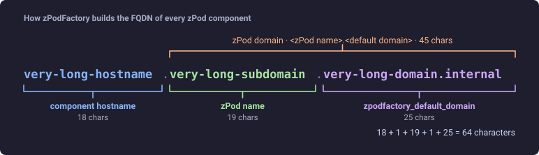
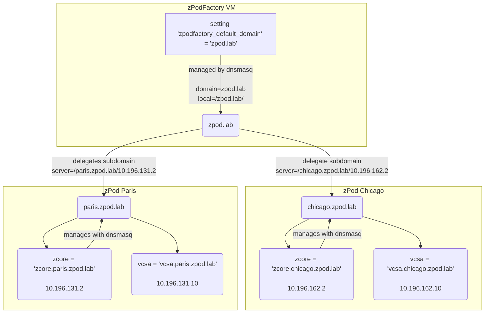
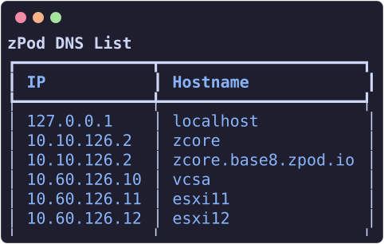

# DNS records

Since version 0.7.2, DNS records can be managed dynamically through the CLI. This requires a `zcore-*` (or legacy `zbox-*`) core component in the deployment profile.

The core appliance serves the zPod's DNS zone, `<zPod name>.<default domain>`; see [How zPod DNS works](#how-zpod-dns-works).

!!! warning
    **Do not change DNS records for zPodFactory-managed components.** Hostnames such as `zcore`, `esxi11`, `vcsa`, `nsx`, and others created by deploy or `zpod component add` are owned by the platform. Deployments, config scripts, certificate flows, and component lifecycle all assume those names and IPs stay in sync. Updating, re-pointing, or removing them — via `zcli zpod dns`, the API, or manual edits on the core VM — can break connectivity for the entire zPod and is difficult to recover from cleanly.

    Use DNS management only for **extra** names you add yourself (overlays, guest subnets, demos, external endpoints). Leave platform records alone.

## How zPod DNS works

DNS is a hierarchical system that resolves names to IP addresses. In zPodFactory the main domain is set using the `zpodfactory_default_domain` variable

This domain is used to configure the DNS server running on the zPodFactory VM. The DNS server is configured to resolve all domain set by the `zpodfactory_default_domain` to the IP address of the zPodFactory VM

Then for **EACH** zPod deployed, they get their own unique subdomain

The subdomain is composed of the zPod name and the `zpodfactory_default_domain`

For example, if the `zpodfactory_default_domain` is set to `zpodfactory.local` and the zPod name is `zpod-a`, then the subdomain will be `zpod-a.zpodfactory.local`.

Every component deployed in that zPod then gets its FQDN as `<hostname>.<zPod name>.<default domain>`, for example `esxi11.zpod-a.zpodfactory.local`:



The total length of that FQDN is validated at creation time against the 64-character Linux hostname limit — see [`zpodfactory_fqdn_reserved_chars`](../admin/feature-flags.md#zpodfactory_fqdn_reserved_chars).

!!! warning
    Every zPod has a unique name, as it's used to generate the subdomain. If you try to deploy a zPod with the same name as an existing one, the deployment will fail

Quick representation on how it works:

- The `zpodfactory_default_domain` is set to `zpod.lab` in this example, and is hosted by the zPodFactory VM.
    - the local dnsmasq service is configured to resolve `zpod.lab`
- The subdomain `chicago.zpod.lab` is delegated to the zPod Chicago **`zcore`** (legacy zPods may use `zbox`)
    - the subdomain `paris.zpod.lab` is delegated to the zPod Paris **`zcore`**

- The zPod Chicago is deployed with the name `chicago`
    - The local dnsmasq service on the chicago **`zcore`** is configured to resolve all names ending with `chicago.zpod.lab`

- The zPod Paris is deployed with the name `paris`
    - The local dnsmasq service on the paris **`zcore`** is configured to resolve all names ending with `paris.zpod.lab`



This also means any zPod Admin owns his subdomain and can add DNS entries on that zPod's local DNS server.

Since **`zcore-13.5`**, component hostnames (the `<hostname>` part of the FQDN shown above) are **added automatically** when zPodFactory deploys or adds components. The zPod Engine calls the core appliance's **`zboxapi` `/dns` API**, which writes records into `/etc/hosts` and reloads dnsmasq — you no longer maintain a large static `/etc/hosts` template on the core VM. A fresh `zcore` image only seeds `localhost` and the core hostname itself; everything else appears as components come up.

## List DNS records to a zPod

List DNS records for a zPod (managed via the core appliance's DNS API):

``` {data-copy="zcli zpod dns list zpod_name"}
❯ zcli zpod dns list zpod_name
```




## Add DNS record to a zPod


Adding a DNS record is useful for hostnames on overlay networks or other subnets not auto-managed by component deploy:

You can use 2 different ways to achieve this:

Using `--host-id` which allows you to set the host id on the management network of a zPod.


``` {data-copy="zcli zpod dns add zpod_name --hostname samplename --host-id 11"}
❯ zcli zpod dns add zpod_name --hostname samplename --host-id 11
```
in this case if your zpod management network was for example 192.168.10.0/26, the IP address of the DNS record will be `192.168.10.11`

`host-id` is the host id on the management network of a zPod. This is explicitely used for `profiles` so we can easily set specific `components` configuration that will be deployed on the zpod management subnet and just have to make sure the `host-id` is set correctly/unique per `profile`.


Example base profile:

```json
[
  {
    "component_uid": "zcore-13.7"
  },
  [
    {
      "component_uid": "esxi-8.0u3i",
      "host_id": 11,
      "hostname": "esxi11",
      "vcpu": 6,
      "vmem": 48
    },
    {
      "component_uid": "esxi-8.0u3i",
      "host_id": 12,
      "hostname": "esxi12",
      "vcpu": 6,
      "vmem": 48
    }
  ],
  {
    "component_uid": "vcsa-8.0u3i"
  }
]
```

Resulting DNS records for zPod `podname`:

```
zcore.podname.zpodfactory.domain -> 10.10.11.2
esxi11.podname.zpodfactory.domain -> 10.10.11.11
esxi12.podname.zpodfactory.domain -> 10.10.11.12
vcsa.podname.zpodfactory.domain -> 10.10.11.10
```

Using `--ip` which allows you to set any IP.

``` {data-copy="zcli zpod dns add zpod_name --hostname samplename --ip 10.10.10.11"}
❯ zcli zpod dns add zpod_name --hostname samplename --ip 10.10.10.11
```

As you can imagine setting any ip, allows you to setup hostnames for any IP address, which can be useful for any use cases leveraging other network subnets (like any overlay network managed by NSX that might be routed within the zPod, etc)

## Update DNS record on a zPod

``` {data-copy="zcli zpod dns update zpod_name --hostname samplename --ip 10.10.10.12"}
❯ zcli zpod dns update zpod_name --hostname samplename --ip 10.10.10.12
```

## Remove DNS record from a zPod

Remove a DNS record can be done using the below command line:

``` {data-copy="zcli zpod dns remove zpod_name --hostname samplename --ip 10.10.10.11"}
❯ zcli zpod dns remove zpod_name --hostname samplename --ip 10.10.10.11
```

!!! warning
    You are responsible for any DNS record change, as deleting one of the core components **WILL** completely break the zPod.
