# Networks

!!! info "Requirements"
    zpodcore **0.9.0** or later. Masquerade and enable/disable need **zcore 13.7** (zboxapi 0.2.0 or later) on the zPod. On an older zcore, the API refuses those two actions up front with a `501`, and zpodweb shows them as unavailable.

Every zPod is deployed with four networks: the management network and three routed `/26` networks. You can add your own VLAN networks to a zPod. Each one gets its own subnet, served by the zPod's zcore.

You can manage networks from the CLI (`zcli zpod network`, below) or from the **Networks** card on the zPod detail page in [zpodweb](web-ui.md#zpod-networks). See [In zpodweb](#in-zpodweb) for what it looks like.

## Concepts

- **Kind**: every network on zcore has one of three kinds.
    - `zpod`: the four networks created at deploy time (`mgmt`, `vlan64`, `vlan128`, `vlan192`). They are routed globally and cannot be changed.
    - `zcore`: VLANs 10, 20 and 30 (`172.16.10/20/30.0/24`). The zcore image configures them for nested VCF. They are read live from zcore and cannot be changed.
    - `user`: the networks you add.
- **VLAN**: the tagged VLAN id the network uses on the zPod's trunk. Pick any id from 1 to 4094 that is not already used on the zPod.
- **Gateway**: the address zcore takes on that VLAN, with its prefix. For example, `10.42.111.1/24` means the network is `10.42.111.0/24` and zcore is `10.42.111.1`.
- **Routing**: `local` (the default) keeps the network inside the zPod. `global` advertises it to the NSX fabric, and only superadmins can set it.
- **Masquerade**: lets VMs on the network reach outside the zPod. Traffic leaves with zcore's address as its source. Nothing outside the zPod can reach those VMs. It is off by default.
- **Status**: read live from zcore on each list. `ACTIVE` means the interface is up, `DISABLED` means it was turned off, `MISSING` means zcore no longer has it, `UNKNOWN` means zcore cannot be reached, and `PENDING` means a routing change is running.

!!! info "Reserved VLAN ids"
    zcore reserves VLAN ids `10`, `20`, `30`, `64`, `128` and `192`, and refuses them with a `403`. Ids `64`, `128` and `192` are the zPod's own `/26` networks.

## Permissions

| Action | Who |
| --- | --- |
| List networks, follow a routing run | Anyone with read access to the zPod |
| Add, remove, enable, disable, masquerade | zPod `OWNER` or `ADMIN` |
| Routing `global` or `local` | Superadmin only |

## List networks

``` {data-copy="zcli zpod network list zpod_name"}
❯ zcli zpod network list zpod_name
```

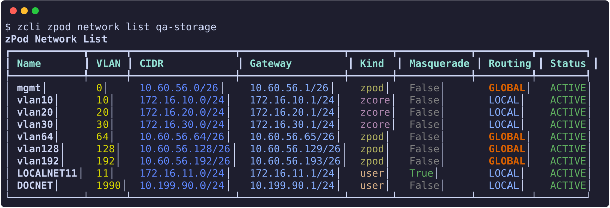

The table shows name, VLAN, CIDR, gateway, kind, masquerade, routing and the live status. `GLOBAL` routing is shown in orange because the network is reachable from the whole fabric.

| Option | Meaning |
| --- | --- |
| `--kind`, `-k` | Show only these kinds: `zpod`, `zcore`, `user`. Repeat the option or give a comma-separated list. |
| `--json`, `-j` | JSON output |

``` {data-copy="zcli zpod network list zpod_name -k user"}
❯ zcli zpod network list zpod_name -k user
```

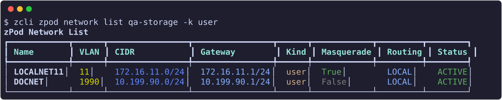

`zcli zpod info <zpod_name>` also reads each network's VLAN, gateway and routing from the API. Its static routes panel lists the global networks, and the zcore box shows every interface, user VLANs included (`-f n`):

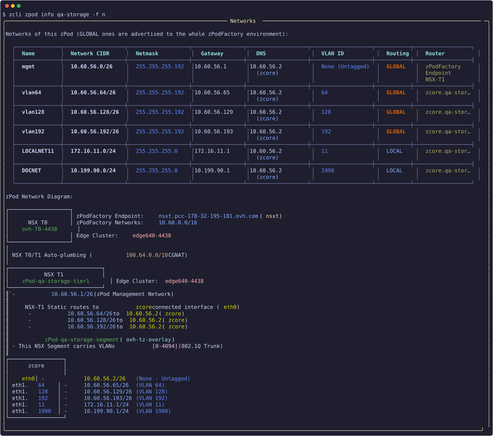

## Add a network

``` {data-copy="zcli zpod network add zpod_name --name wld01 --vlan 1000 --gateway 10.42.111.1/24"}
❯ zcli zpod network add zpod_name --name wld01 --vlan 1000 --gateway 10.42.111.1/24
```

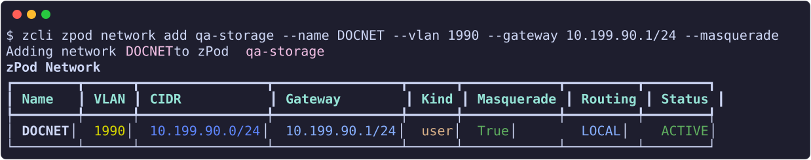


| Option | Required | Default | Meaning |
| --- | --- | --- | --- |
| `--name` | yes | | Network name: letters, digits and `-` |
| `--vlan` | yes | | VLAN id, 1 to 4094, not reserved |
| `--gateway` | yes | | zcore's address on the VLAN, with its prefix |
| `--masquerade` | no | off | Source-translate traffic leaving the zPod |
| `--routing` | no | `local` | `local`, or `global` (superadmin only) |

If the request is refused, nothing is created. The API checks that:

- the VLAN id and the name are not already used on the zPod (`409`);
- the subnet does not overlap any of the zPod's networks or the endpoint's zPod pool (`422`);
- the VLAN id is not reserved by zcore (`403`).

## Remove a network

``` {data-copy="zcli zpod network remove zpod_name wld01"}
❯ zcli zpod network remove zpod_name wld01
```

Removing a network deletes its VLAN interface and subnet on zcore. Add `-y` to skip the confirmation. Removal is refused (`409`) while:

- the network is routed `global`: set it back to `local` first;
- a routing change is running;
- zPod DNS records still point into the subnet: delete them first with `zcli zpod dns remove`.

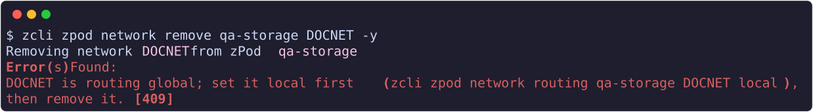


## Masquerade

``` {data-copy="zcli zpod network masquerade on zpod_name wld01"}
❯ zcli zpod network masquerade on zpod_name wld01
❯ zcli zpod network masquerade off zpod_name wld01
```

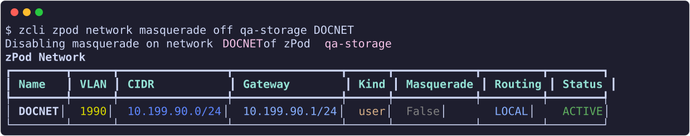


With masquerade on, VMs on the network can reach the factory network and anything it reaches. With it off, the network has no egress and stays inside the zPod. Masquerade cannot be turned on for a `global` network (`409`), because a global network is already reachable without translation.

## Enable and disable

``` {data-copy="zcli zpod network disable zpod_name wld01"}
❯ zcli zpod network disable zpod_name wld01
❯ zcli zpod network enable zpod_name wld01
```

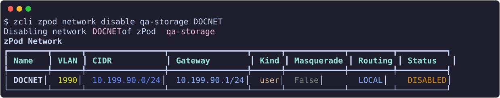


These commands bring the VLAN interface down or up on zcore. The change does not survive a zcore reboot. Disabling a `global` network blackholes its subnet in the fabric, which can be useful for a failure test.

## Routing: advertise to the fabric

A new network is `local`: it lives only inside the zPod. Its VMs can reach out through masquerade, but nothing outside the zPod can reach them, since the NSX fabric has no route to the subnet. That is enough for most labs.

Advertise a network (`global`) when something outside the zPod must reach the VMs on it directly, by their own IPs. For example: a VCF workload domain on `wld01` that a jump host, another zPod or the corporate network must reach, or a replication or backup target that a second zPod connects to. zPodFactory then adds a T1 static route to the subnet, through zcore, and the fabric routes it like any zPod network.

Only superadmins can change routing, because an advertised subnet becomes part of the whole lab's routing. As a zPod owner, ask a superadmin to advertise the network for you. Each change runs as an audited zPod Engine flow, named `advertise <zpod>/<network> by <user>` or `withdraw …`. The network shows `PENDING` while the flow runs. By default the command follows the run and prints the verdict. On success it prints the final routing and masquerade state. On failure it prints the failing check in red and exits with code 1.

| Option | Meaning |
| --- | --- |
| `--dry-run` | Run the fabric checks only and change nothing |
| `--no-wait` | Return as soon as the run starts (Ctrl-C while waiting also leaves the run going) |

The captures below use a throwaway test network, `DOCNET`, on the zPod `qa-storage`.

### 1. Check first, with a dry run

Before advertising anything, run the same checks without changing the fabric. This tells you whether the subnet clashes with anything the lab already routes, so you can pick another subnet before anyone depends on it:

``` {data-copy="zcli zpod network routing zpod_name wld01 global --dry-run"}
❯ zcli zpod network routing zpod_name wld01 global --dry-run
```

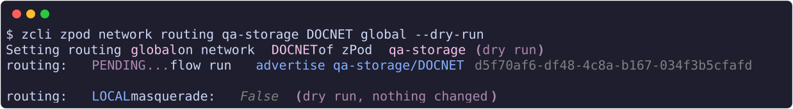

The network stays `LOCAL`, and the output ends with "dry run, nothing changed".

### 2. Advertise the network

When the dry run passes, advertise it for real. The flow runs the checks again, writes the T1 static route, and turns masquerade off, since the VMs now use their own IPs:

``` {data-copy="zcli zpod network routing zpod_name wld01 global"}
❯ zcli zpod network routing zpod_name wld01 global
```

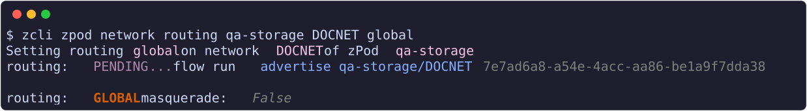

The network is now `GLOBAL`, with masquerade off. Its subnet appears in the zPod's T1 routes and is reachable from the rest of the lab.

### 3. Withdraw it when you are done

When nothing outside the zPod needs the network any more, for example once the test is over, withdraw it. This removes the route and frees the subnet for other labs:

``` {data-copy="zcli zpod network routing zpod_name wld01 local"}
❯ zcli zpod network routing zpod_name wld01 local
```

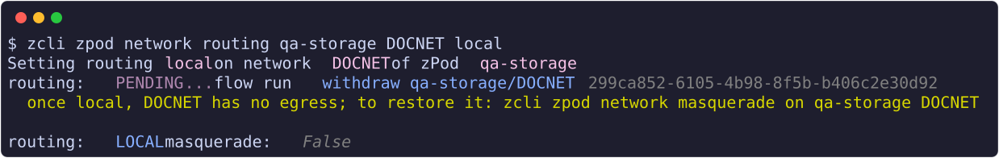

The network is back to `LOCAL`, but masquerade stays off, so its VMs have no egress. As the output reminds you, turn masquerade on again if they still need to reach out.

### What the flow checks and does

Before it advertises a network with `global`, the flow checks that:

- the VLAN is up on zcore;
- the subnet is a unicast subnet between `/8` and `/30`;
- the subnet overlaps nothing the fabric already routes. That covers the T0 routing table of the zPod's endpoint, every T1 static route of every zPod, every segment subnet, and every user network in the database.

It prints the full inventory before each verdict. It then writes a T1 static route `<zpod>-<network>` with zcore as the next hop, waits for NSX to realize it, and turns masquerade off. The checks and the write hold the engine's NSX lock, so no deploy or destroy can change the inventory in between. The run also writes a markdown artifact, `advertisement-<zpod>-<network>`, with the check table and the inventories. You can read it in the Prefect UI.

`local` deletes that route, and only if zPodFactory wrote it. If any step fails, the network goes back to its previous routing.

- Moving a network back to `local` leaves it without egress. Turn masquerade on again if you need it.
- When a zPod is destroyed, its user networks are set back to `local` with masquerade off.

## Errors you may see

| Status | Message (shortened) | What to do |
| --- | --- | --- |
| 403 | A global network requires superadmin privileges | Re-run without `--routing global`, or ask a superadmin |
| 403 | `<name>` is a zPodFactory network (kind zpod) | The four deploy-time networks cannot be changed |
| 403 | `<name>` is a zcore network (kind zcore) | VLANs 10, 20 and 30 belong to the zcore image |
| 409 | VLAN `<id>` / network name is already used on this zPod | Pick another VLAN id or name |
| 409 | `<name>` is routing global; set it local first | Run `routing … local`, then remove |
| 409 | DNS record(s) point into `<cidr>` | Delete those records first |
| 409 | zcore of zPod `<name>` is not ACTIVE | Wait until the zcore component is running |
| 409 | `<name>` has a routing change running | Wait for the flow run to finish |
| 422 | `<candidate>` overlaps with `<network>` | Pick a subnet that does not overlap |
| 501 | zboxapi has no masquerade support | Upgrade the zPod's zcore to 13.7 |
| 503 | zcore of zPod `<name>` is not reachable | Check that the zcore VM is up |

## Using the network in a nested lab

Once the VLAN exists, use its id on nested ESXi portgroups or VM NICs, and use the gateway address on the VMs. VMs on a user VLAN should use zcore's management address as their DNS server. You can add records for hosts on the subnet with `zcli zpod dns add`. See [Manage DNS records](dns.md).

## In zpodweb

zpodweb 0.2.0 shows the same networks on the zPod detail page. The screenshots below are from zpodweb 0.2.0 on a test zPod; click one to zoom in.

### Networks card

Every network on zcore with its live status, grouped by kind: the zPod's own networks (routed globally), zcore's VLANs for nested VCF, and your user networks. Each group folds from its header, and zpodweb remembers which groups you folded.

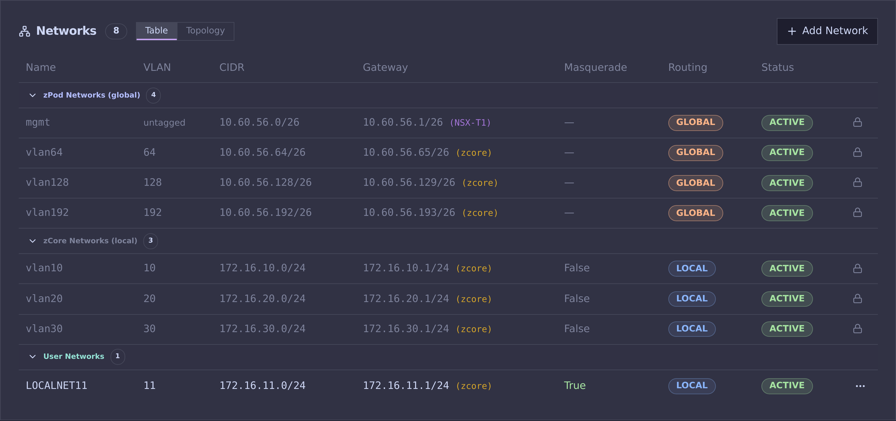

A user network's menu offers enable or disable, masquerade on or off, routing (superadmin only), a shortcut to the Topology tab, and removal:

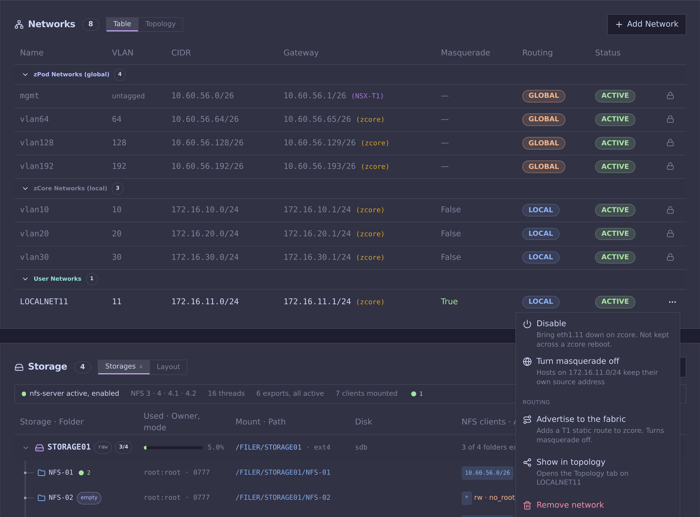

### Add a network

The dialog derives the subnet, the interface on zcore and the usable range from the gateway, and checks reserved VLANs, duplicates and overlaps with the zPod's networks and the endpoint pool before anything is sent.

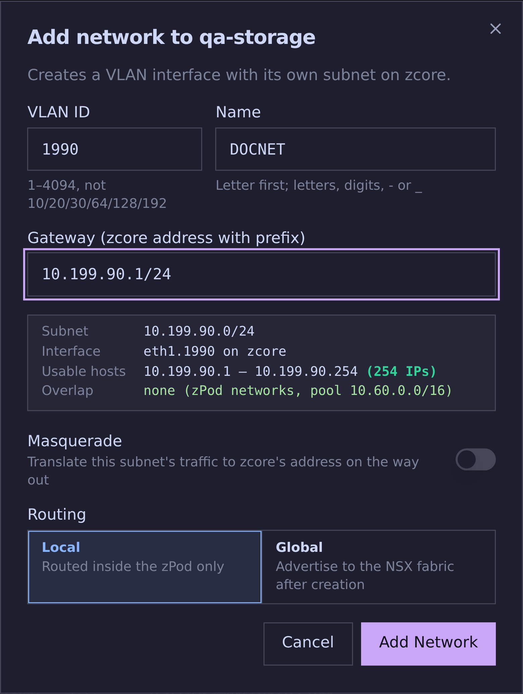

### Advertise to the fabric

A superadmin advertises a network, or withdraws it. The dialog says what the run checks and changes, offers a dry run, then follows the zPod Engine run to its verdict, with the failing check shown when it fails.

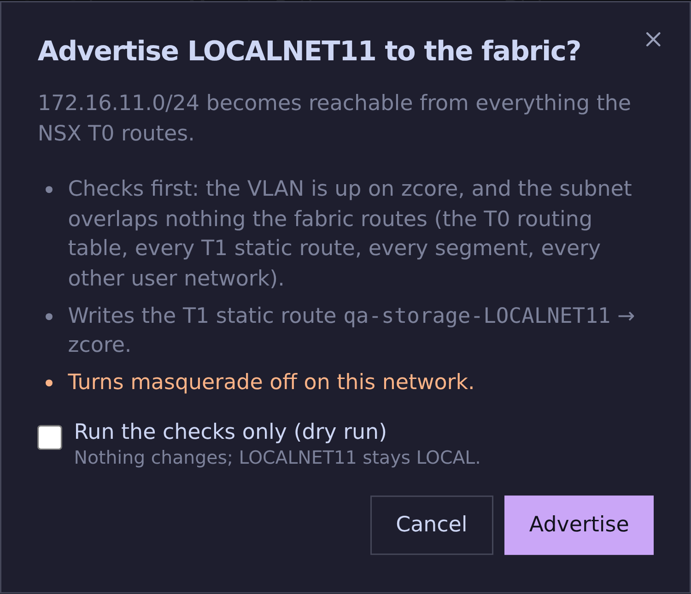

### Topology tab

The Networks card's **Topology** tab draws zcore and everything upstream of it. Pick a user network and a path (to the internet, from the fabric, to the management network) to see the packet's way, with a verdict on why it works or is blocked. The tab, network and path are in the page URL, so a link opens the same view.


### Network Topology card

The zcore box lists every interface grouped by kind with a live status dot, and the T1 static routes include the user networks that are advertised.

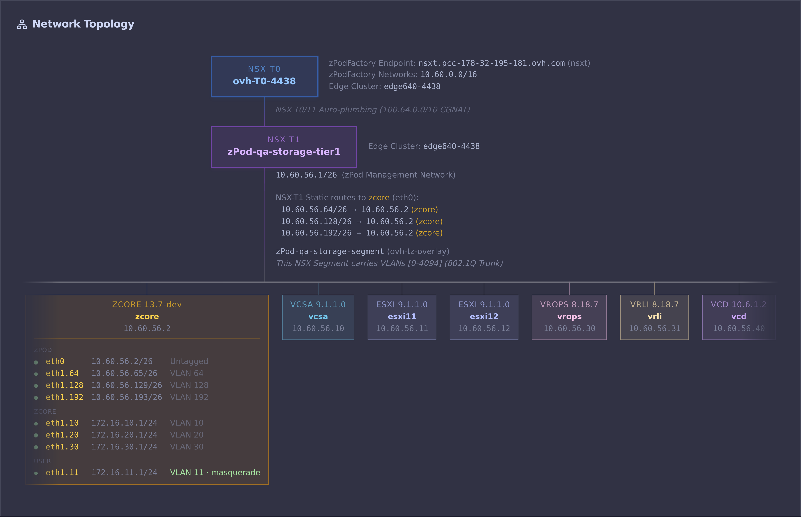

## API

| Method and path | Purpose |
| --- | --- |
| `GET /zpods/{id}/networks` | List, with live status (needs zPod read access) |
| `POST /zpods/{id}/networks` | Add (`name`, `vlan`, `gateway`, `masquerade`, `routing`) |
| `DELETE /zpods/{id}/networks/{name}` | Remove |
| `PUT /zpods/{id}/networks/{name}/enable` | Bring the interface up |
| `PUT /zpods/{id}/networks/{name}/disable` | Bring the interface down |
| `PUT /zpods/{id}/networks/{name}/masquerade` | Turn masquerade on or off |
| `PUT /zpods/{id}/networks/{name}/routing` | `global` or `local`, optional `dry_run`; answers `202` with the flow run id |
| `GET /zpods/{id}/networks/{name}/routing/{flow_run_id}` | State of a routing run, with the failing check |
