# Storage and NFS

!!! info "Requirements"
    zpodcore **0.9.0** or later, and **zcore 13.7** (zboxapi 0.2.1 or later) on the zPod. Every storage route checks zcore first. It answers `409` when the zcore component is not `ACTIVE`, `501` when zboxapi is too old, and `503` when zcore does not answer. zPods deployed from an older zcore keep working, but they cannot use these commands.

Each zPod's zcore runs an NFS filer. The deploy gives it a system disk and a filer disk, which is mounted as `/FILER/STORAGE01` and holds the shares the nested hosts use (`NFS-01`, `NFS-VCD`, `VCF-BACKUPS`). Storage self-service lets you add disks to the zcore VM, turn them into more storages, organize folders on them, and export those folders over NFS to the clients you choose.

There are three layers, each with its own `zcli` command group:

| Layer | Command | What it is |
| --- | --- | --- |
| Disk | `zcli zpod disk` | A thin virtual disk on the zcore VM |
| Storage | `zcli zpod storage` | A filesystem on a disk, mounted under `/FILER/STORAGEnn` |
| Export | `zcli zpod nfs` | A folder of a storage, shared over NFS |

You can also do all of this from the **Storage** card on the zPod detail page in [zpodweb](web-ui.md#zpod-storage); see [In zpodweb](#in-zpodweb) for what it looks like. All sizes are in GiB.

## Permissions and limits

- Anyone with read access to the zPod can list disks, storages, folders and exports.
- A zPod `OWNER` or `ADMIN` can change them.
- A single disk can be at most `zpodfactory_zpod_disk_max_gb` (default `2048` GiB). Superadmins can exceed it.
- A disk add or grow is refused when it would leave the zcore VM's datastore with less free space than `zpodfactory_datastore_min_free_pct` (default `15`%). The full size counts, even for a thin disk. This limit applies to everyone. See [Settings & feature flags](../admin/feature-flags.md#zcore-storage).
- Only one disk change can run at a time per zPod.

## Quick start

To add a 500 GiB storage, export it, and mount it on the nested ESXi hosts:

``` {data-copy="zcli zpod storage add zpod_name --size 500"}
❯ zcli zpod storage add zpod_name --size 500
❯ zcli zpod nfs add zpod_name STORAGE02 DS02
❯ zcli zpod nfs list zpod_name
```

Then mount `zcore.<zpod domain>:/FILER/STORAGE02/DS02` as an NFS 3 datastore in the nested vCenter.

## Disks

``` {data-copy="zcli zpod disk list zpod_name"}
❯ zcli zpod disk list zpod_name
❯ zcli zpod disk add zpod_name --size 500
❯ zcli zpod disk grow zpod_name /dev/sdc --size 800
❯ zcli zpod disk remove zpod_name /dev/sdc
```

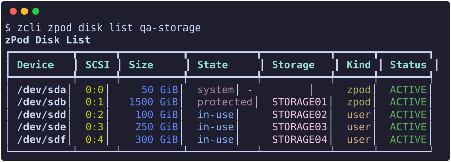

- **list** shows each disk's device, SCSI unit, size, and what zcore sees on it: `system`, `protected`, `blank`, `foreign`, or `in-use` with the storage name. It also shows the kind (`zpod` for the deploy's two disks, `user` for disks you added) and the status. `--kind zpod,user` filters the list, and `-j` gives JSON.
- **add** puts a blank thin disk on the next free SCSI unit of the zcore VM.
- **grow** sets a new, larger total size. You can grow the filer disk, but never the system disk. To use the new space, grow the storage on the disk afterwards (`zcli zpod storage grow`).
- **remove** deletes a blank or foreign disk you added, along with its data. It is refused while the disk is in use (`409`) and for the deploy's own disks (`403`). Add `-y` to skip the confirmation.

Disk changes run as zPod Engine flows (`add disk <zpod>/<size>GiB by <user>` and similar). By default each command follows its run and prints how it ended, with exit code 1 on failure. Pass `--no-wait` to return at once. A failed add leaves nothing behind. You can retry a failed grow or remove.

zcore identifies each disk by its serial, which is the vSphere disk UUID. A device name that changes after a reboot therefore changes nothing.

## Storages

``` {data-copy="zcli zpod storage list zpod_name"}
❯ zcli zpod storage list zpod_name
```

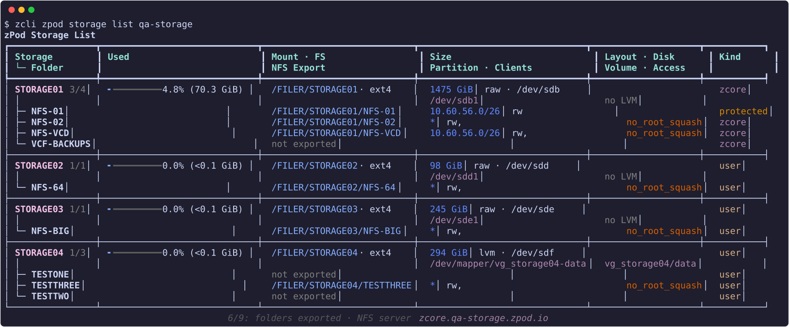

The list shows each storage with its usage, mount point, size, partition, layout and disk. Below each storage is its folder tree, with each folder's export, clients and access. The table caption shows the NFS server state. `--kind zcore,user` filters the list (`zcore` is STORAGE01), and `-j` gives JSON.

### One-step commands

These commands combine the disk and storage steps:

``` {data-copy="zcli zpod storage add zpod_name --size 500 --lvm"}
❯ zcli zpod storage add zpod_name --size 500 [--lvm] [--name STORAGE05]
❯ zcli zpod storage grow zpod_name STORAGE02 --size 1000
❯ zcli zpod storage remove zpod_name STORAGE02
```

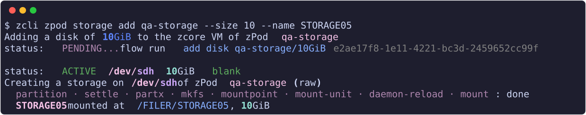

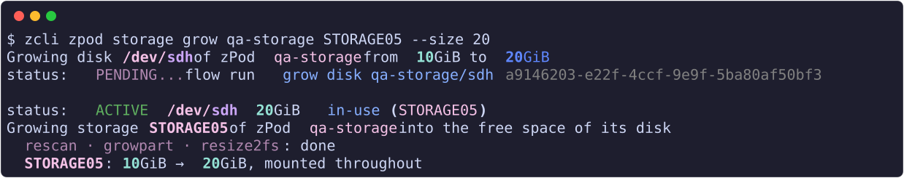

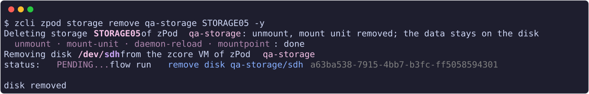


- **add** adds a new disk, then creates a storage on it. The default name is the next free `STORAGEnn`.
- **grow** with `--size` grows the disk to that total size first, then grows the storage into the new space, online.
- **remove** deletes the storage, then removes its disk with all its data. It asks for confirmation once (`-y` skips it).

### Step by step

``` {data-copy="zcli zpod storage create zpod_name --disk /dev/sdc --dry-run"}
❯ zcli zpod storage create zpod_name --disk /dev/sdc [--lvm] [--name STORAGE02] [--dry-run]
❯ zcli zpod storage grow zpod_name STORAGE02
❯ zcli zpod storage delete zpod_name STORAGE02
❯ zcli zpod storage adopt zpod_name --device /dev/sdc1 [--name STORAGE02]
```

- **create** partitions, formats and mounts a blank disk of the zPod. The layout is a raw partition by default. Pass `--lvm` for a single LVM volume.
- **grow** without `--size` grows the storage into free space its disk already has, for example after `zcli zpod disk grow`. This works for STORAGE01 too.
- **delete** unmounts a storage. The filesystem and its data stay on the disk. It is refused while a folder of the storage is exported.
- **adopt** mounts an existing filesystem again as a storage, with its data intact. Pass a partition (`/dev/sdc1`) or an LVM volume (`vg/lv`).

A storage that still has an export is refused, whichever way you delete it:

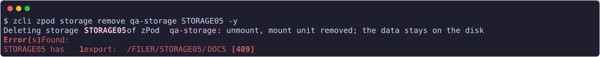

`create`, `adopt`, `grow` and `delete` accept `--dry-run`, which shows the planned steps without running them, and `--verbose`, which shows each step's command and output. For example, growing an LVM storage:

``` {data-copy="zcli zpod storage grow zpod_name STORAGE04 --dry-run --verbose"}
❯ zcli zpod storage grow zpod_name STORAGE04 --dry-run --verbose
```

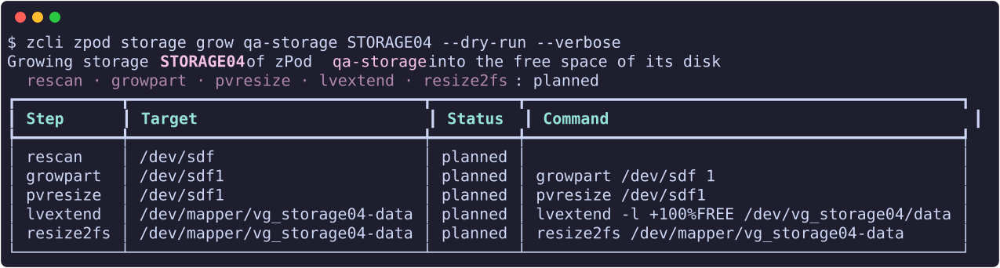

If a step fails, the CLI prints the error, the step that failed, and what was rolled back.

zcore only formats or adopts a disk that zPodFactory recorded for this zPod (`403` otherwise). A disk attached to the zcore VM by hand is never touched.

## Folders

``` {data-copy="zcli zpod storage folder list zpod_name STORAGE02"}
❯ zcli zpod storage folder list zpod_name STORAGE02
❯ zcli zpod storage folder add zpod_name STORAGE02 DS02 [--owner root:root] [--mode 0777]
❯ zcli zpod storage folder set zpod_name STORAGE02 DS02 --mode 0755 [--owner user:group] [--recursive]
❯ zcli zpod storage folder remove zpod_name STORAGE02 DS02 [--force]
```

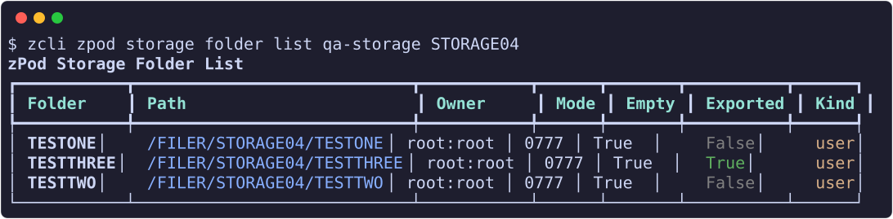

New folders default to owner `root:root` and mode `0777`. `set --recursive` also applies the change to everything below the folder. `remove` refuses a folder that is exported. Pass `--force` to remove a folder that is not empty, along with its contents.

## NFS exports

``` {data-copy="zcli zpod nfs list zpod_name"}
❯ zcli zpod nfs list zpod_name
❯ zcli zpod nfs status zpod_name
```

- **list** shows every export: the ones zcore's image writes to `/etc/exports` (owner `system`) and the ones you added.
- **status** shows the NFS server on one line, then each export with the hosts that currently have it mounted.

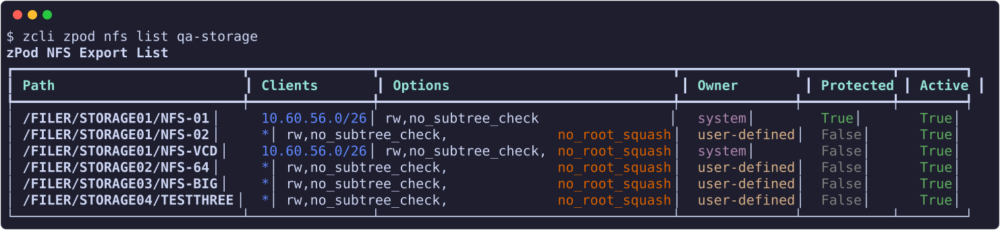

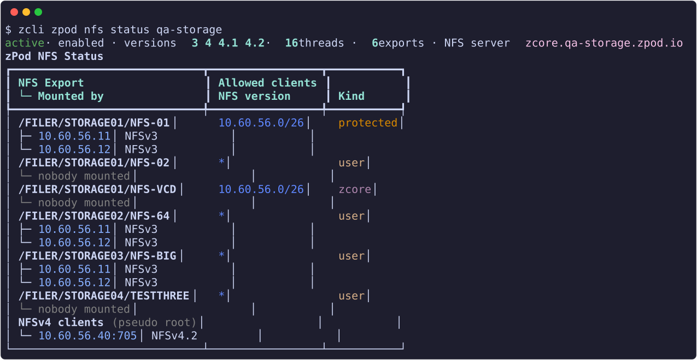

### Add, change, remove

``` {data-copy="zcli zpod nfs add zpod_name STORAGE02 DS02 -c 10.42.111.0/24"}
❯ zcli zpod nfs add zpod_name STORAGE02 DS02 [-c 10.42.111.0/24] [-o rw,no_subtree_check,no_root_squash]
❯ zcli zpod nfs set zpod_name STORAGE02 DS02 -c 10.42.111.0/24,10.96.1.10 [-o ro,no_subtree_check]
❯ zcli zpod nfs client add zpod_name STORAGE02 DS02 10.96.1.11
❯ zcli zpod nfs client remove zpod_name STORAGE02 DS02 10.96.1.11
❯ zcli zpod nfs remove zpod_name STORAGE02 DS02
```

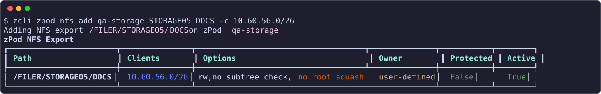

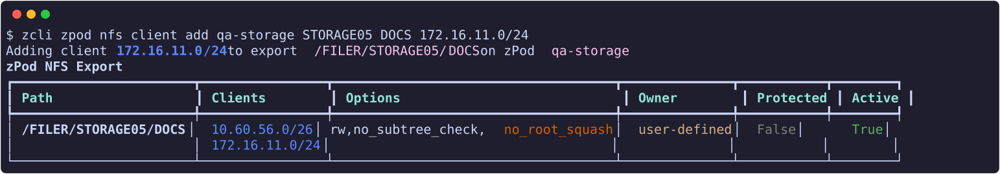


- **add** exports a folder of a storage, and creates the folder when it is missing.
    - `--clients`/`-c`: who may mount it. Give an IPv4 address, an IPv4 network, or `*`, either comma-separated or as repeated options. The default is `*`, meaning any host that can reach zcore.
    - `--options`/`-o`: `exports(5)` options for every client. The default is `rw,no_subtree_check,no_root_squash`.
- **set** makes an export exactly what you give it. The client list is replaced, and so are the options when you pass `-o`. The export is created when it is missing.
- **client add** and **client remove** change one client. Removing the last client removes the export, so the CLI asks first.
- **remove** stops exporting the folder. The folder and its data always stay.

The list shows `no_root_squash` in orange as a reminder that root on the client is root on the export.

zcore's own exports are read-only through zPodFactory, and `NFS-01` cannot be changed at all (`403`).

### Mount an export

Mount an export in a nested vCenter as an NFS 3 datastore, with server `zcore.<zpod domain>` and the export path, for example `/FILER/STORAGE02/DS02`. On Linux:

```bash
mount -t nfs zcore.<zpod domain>:/FILER/STORAGE02/DS02 /mnt/ds02
```

zpodweb shows ready-to-copy ESXi and Linux mount commands next to each export.

## zPod info

`zcli zpod info <zpod_name>` has a **Storage** panel, shown by default. It lists zcore's storages with size, usage and disk, and the NFS exports with their clients. Show it alone with `-f s`. On an older zcore, the panel says why it is empty.

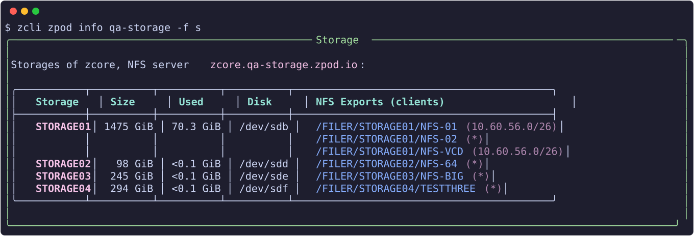

## In zpodweb

zpodweb 0.2.0 shows the same disks, storages and exports in a **Storage** card on the zPod detail page, under Networks. The screenshots below are from zpodweb 0.2.0 on a test zPod; click one to zoom in.

### Storages tab

A line at the top gives the NFS server's state, its versions and threads, how many exports and mounted clients there are. Below it, each storage with its folders as a tree: a usage bar coloured by how full it is (the sizes on hover), the raw or LVM layout, the mount and path, the disk, and each folder's NFS clients and access. A pulsing dot marks a folder some host has mounted (who, on hover), and its share (`zcore.<domain>:<path>`) is one click from the clipboard. Protected items show a lock instead of a menu.

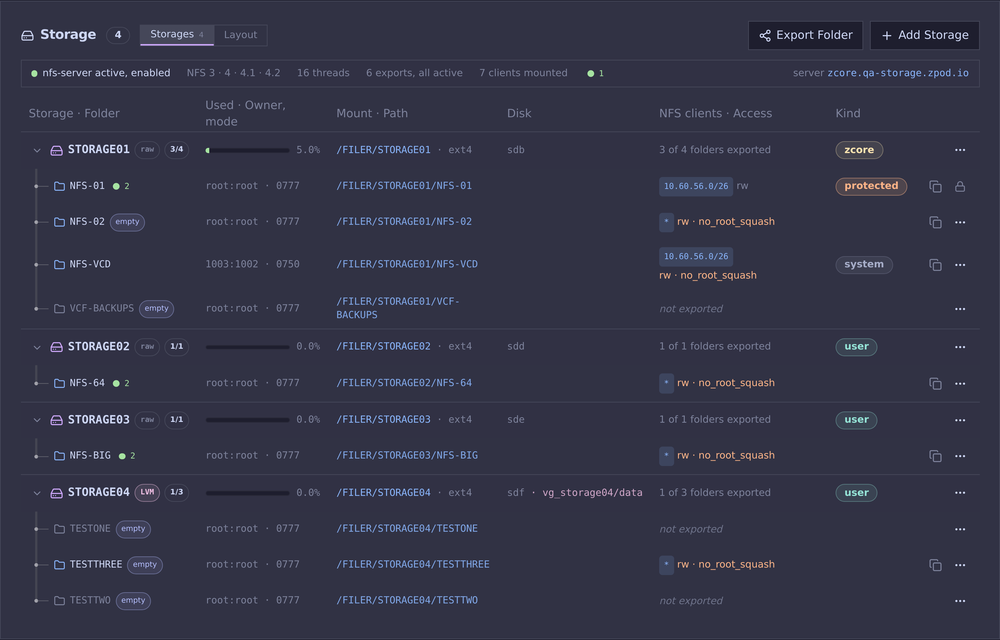

A storage's menu offers grow, add folder and delete; folders have their own menu for export, owner and mode, and removal:

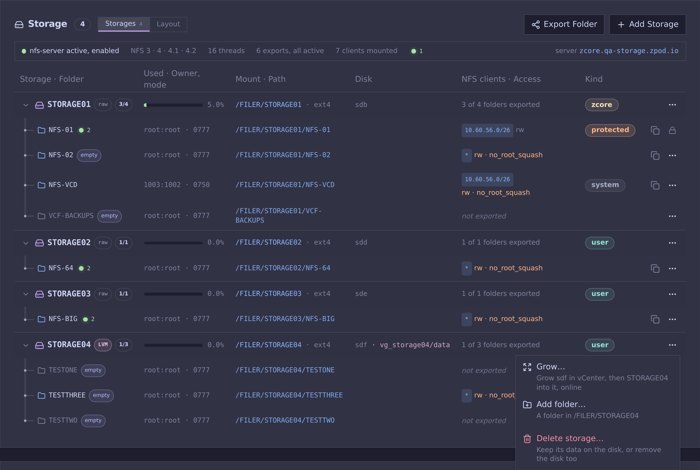

### Layout tab

Each of zcore's disks with what is on it: the layout, the storage with its usage and mount, and its folders with their NFS clients, plus the total space assigned for storage.

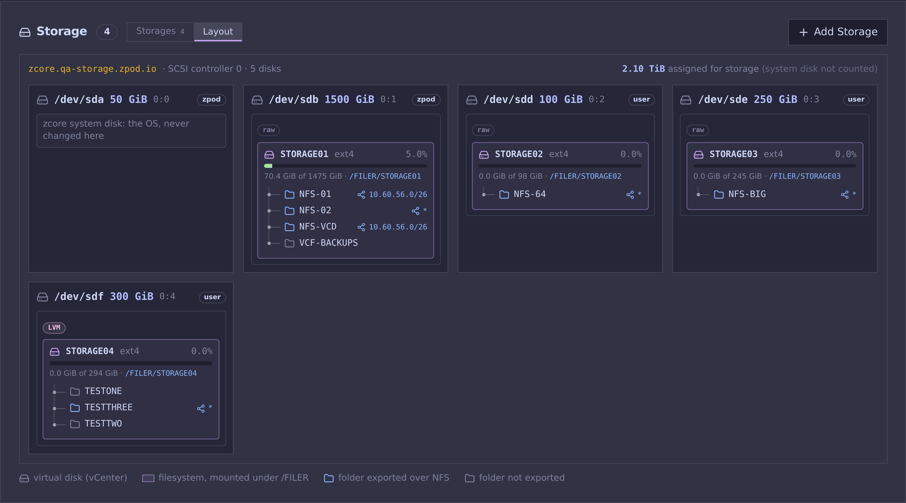

### Dialogs

| Add a storage | Export a folder over NFS |
| --- | --- |
| 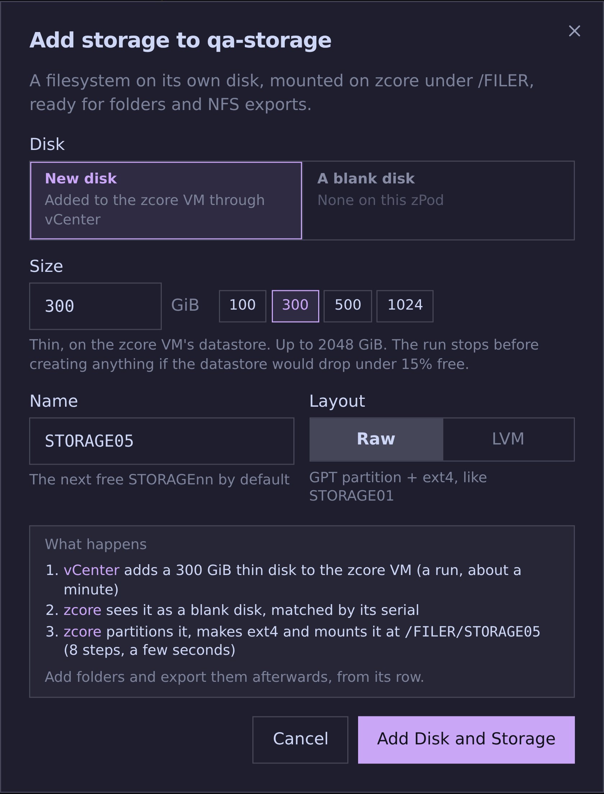 | 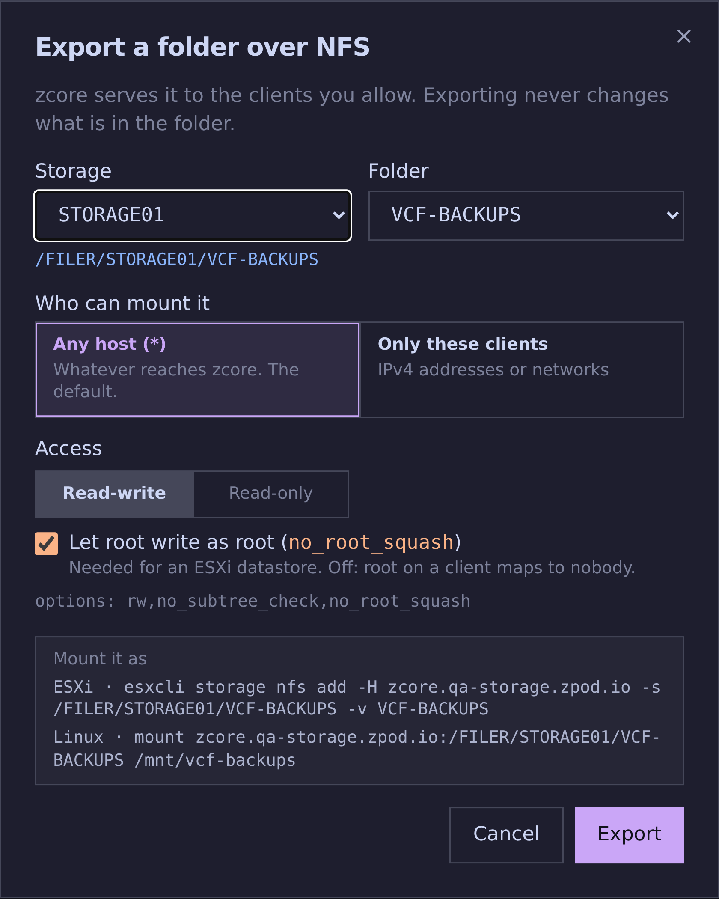 |
| On a new disk, added through vCenter, or on a blank disk of the zPod; the dialog then follows the vCenter run and zcore's steps. | Any host or chosen clients (the zPod's networks offered in one click), read-write or read-only, `no_root_squash`, and ready-to-copy ESXi and Linux mount commands. |

**Delete a storage**: keep the data on the disk (the default), or remove the disk too after typing the storage's name. An exported folder must be unexported first, and the dialog offers it in one click:

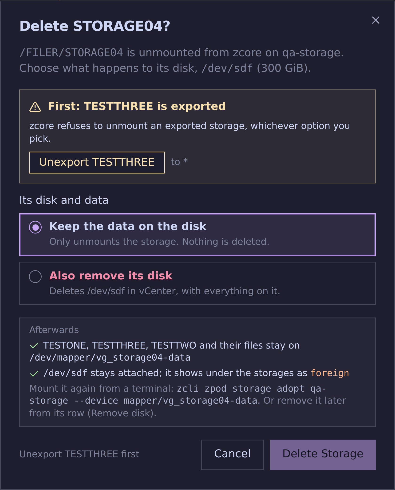

## API

Disk changes answer `202` with a zPod Engine run.

| Method and path | Purpose |
| --- | --- |
| `GET /zpods/{id}/disks` | List disks |
| `POST /zpods/{id}/disks` | Add a disk (`size_gb`) |
| `GET /zpods/{id}/disks/{device}` | Get a disk |
| `DELETE /zpods/{id}/disks/{device}` | Remove a disk |
| `PUT /zpods/{id}/disks/{device}/grow` | Grow a disk |
| `GET /zpods/{id}/disks/runs/{flow_run_id}` | State of a disk run |
| `GET /zpods/{id}/storages` | List storages |
| `POST /zpods/{id}/storages` | Create a storage (`disk`, `lvm`, `name`) |
| `POST /zpods/{id}/storages/adopt` | Adopt an existing filesystem |
| `GET /zpods/{id}/storages/{name}` | Get a storage |
| `DELETE /zpods/{id}/storages/{name}` | Delete a storage |
| `PUT /zpods/{id}/storages/{name}/grow` | Grow a storage |
| `POST /zpods/{id}/storages/{name}/folders/{folder}` | Add a folder |
| `PUT /zpods/{id}/storages/{name}/folders/{folder}` | Change a folder's owner or mode |
| `DELETE /zpods/{id}/storages/{name}/folders/{folder}` | Remove a folder |
| `GET /zpods/{id}/nfs` | List exports |
| `GET /zpods/{id}/nfs/status` | NFS server status |
| `POST /zpods/{id}/nfs` | Add an export (`storage`, `folder`, `clients`, `options`) |
| `GET /zpods/{id}/nfs/{storage}/{folder}` | Get an export |
| `PUT /zpods/{id}/nfs/{storage}/{folder}` | Change an export |
| `DELETE /zpods/{id}/nfs/{storage}/{folder}` | Remove an export |
| `POST /zpods/{id}/nfs/{storage}/{folder}/clients` | Add a client to an export |
| `DELETE /zpods/{id}/nfs/{storage}/{folder}/clients/{client}` | Remove a client from an export |
