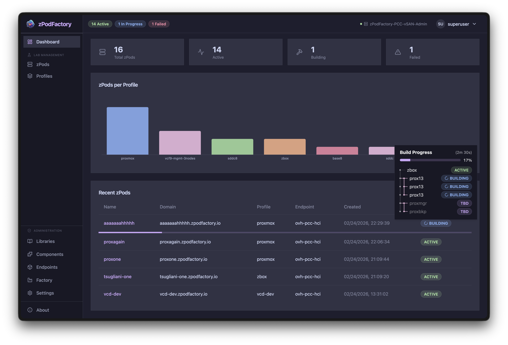
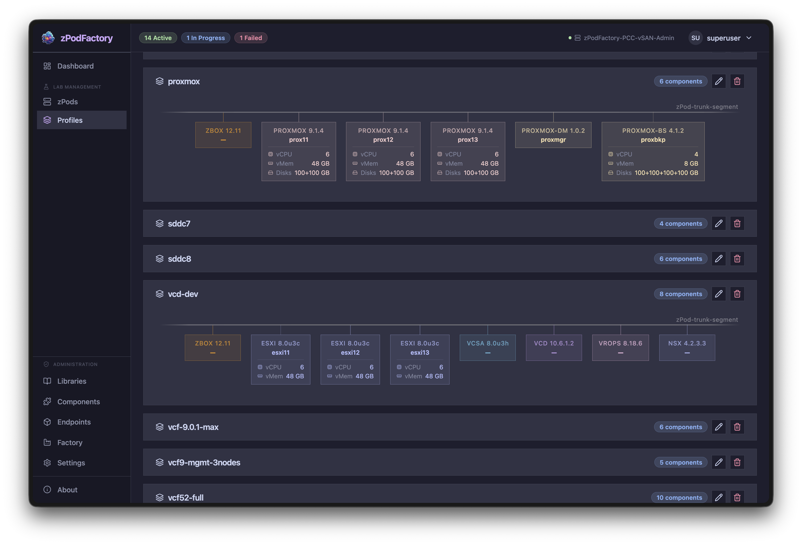
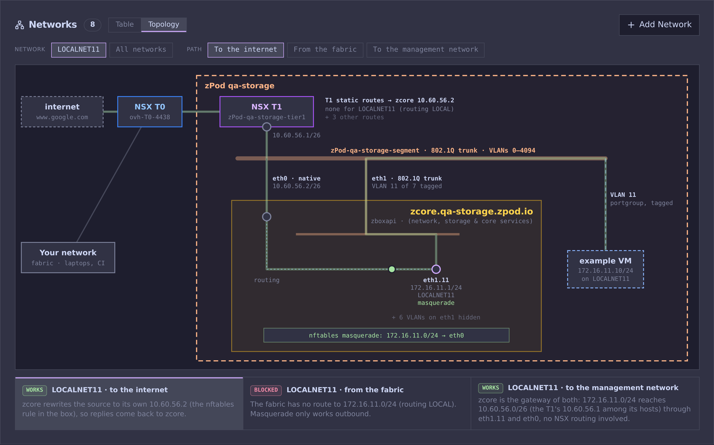

# Web UI (zpodweb)

[zpodweb](https://github.com/zPodFactory/zpodweb) is the official web interface for zPodFactory. It connects to the **zPod API** (`zpodapi`) and provides a visual way to manage zPods, endpoints, components, libraries, profiles, and factory settings — without using the CLI for day-to-day operations.

The UI uses a **Catppuccin Mocha** dark theme, responsive sidebar navigation, and an Nginx reverse proxy so the browser never talks directly to the API (no CORS issues).

## Included with the appliance

The [zPodFactory appliance](../install/index.md#deploy-the-appliance) deploys **zpodweb automatically** during first boot. The appliance install script:

1. Clones [zPodFactory/zpodweb](https://github.com/zPodFactory/zpodweb) into `~/git/zpodweb`
2. Pre-configures `.env` with the appliance API URL (`http://<appliance-ip>:8000`) and API token
3. Starts the zpodweb Docker Compose stack

Once the appliance finishes provisioning, open:

```
http://<appliance-ip>:8500
```

If a single target is configured, zpodweb **auto-connects** on page load — you land directly on the dashboard.

!!! info "Ports on the appliance"
    | Service | Default port | Purpose |
    | --- | --- | --- |
    | **zpodweb** | `8500` | Web UI |
    | **zPod API** | `8000` | REST API / OpenAPI docs at `/docs` |
    | **Prefect UI** | `8060` | Flow engine task monitoring |

## First login

### On the appliance (pre-configured)

The appliance writes the superuser API token into zpodweb's `.env` during install. Browse to `http://<appliance-ip>:8500` — no manual token entry is required when defaults are applied correctly.

### Manual or remote access

If you deploy zpodweb yourself, or connect from a workstation to a remote zPodFactory instance:

1. Open the zpodweb login page
2. Enter the **API URL** (e.g. `http://zpodfactory.domain.lab:8000`)
3. Enter your **API token** (from an administrator, or from `~/.config/zcli/.zclirc` on the appliance)

Target configurations are stored in the browser's `localStorage`. With a single saved target, zpodweb auto-connects on the next visit.

## Features

| Area | What you can do |
| --- | --- |
| **Dashboard** | zPod counts, status distribution, activity charts |
| **zPods** | List, create, inspect, and destroy zPods with full detail views; action buttons stay blocked while a workflow runs |
| **zPod networks** | Add, enable/disable, masquerade and remove VLAN networks; superadmins advertise them to the NSX fabric ([details](#zpod-networks)) |
| **Network topology** | Visio-style interactive diagram: NSX T0/T1, trunk segments, zcore interfaces grouped by kind with live status, T1 static routes, deployed components |
| **zPod storage** | Disks, storages, folders and NFS exports of the zPod's zcore ([details](#zpod-storage)) |
| **zPod permissions** | View, grant and revoke zPod access for users and groups |
| **Endpoints** | Create and edit endpoints, view compute (vSphere) and network (NSX) side by side, pick an optional vSphere Distributed Switch, manage endpoint access |
| **Components** | Searchable, filterable component catalog; enable/disable with download progress; chunked, resumable OVA/ISO upload; depot downloads via [Broadcom download token](../admin/broadcom-download-token.md) |
| **Libraries** | Manage libraries with enable/disable and resync |
| **Profiles** | View, edit, import and export deployment profiles |
| **Users** | Superadmins create, edit, enable/disable, delete users and reset their API token; everyone else edits their own profile |
| **Groups** | Superadmins create, rename and delete permission groups and manage their members |
| **Settings** | View and manage global factory settings |
| **Multi-target** | Save several zPodFactory instances; one is active at a time, a single saved target auto-connects, and the tab title names the active target |
| **About** | Shows the zpodweb version |

## Screenshots

### Dashboard

Overview of zPod counts, status distribution, and recent activity charts.



### Profiles

Browse and inspect deployment profiles and their component definitions.



### Components

The **Components** page is the usual starting point for preparing OVA/ISO files before building profiles or zPods:

- **Browse** — search and filter the full library catalog (all, active, or in-progress downloads); sort by UID, name, version, or status
- **Enable** — triggers the same download engine as `zcli component enable`; VMware products use the factory's configured [Broadcom download token](../admin/broadcom-download-token.md)
- **Upload** — provide binaries manually when depot download is unavailable (equivalent to `zcli component upload`); checksum matching enables the correct component automatically
- **Progress** — live download percentage and status while components are fetched from the depot or verified after upload

Set `zpodfactory_broadcom_download_token` under **Settings** in the Web UI (or via CLI) before enabling Broadcom depot components such as NSX or vCenter OVAs.

## zPod networks

The zPod detail page has a full-width **Networks** card. It is the web side of [`zcli zpod network`](networks.md) and needs zpodcore 0.9.0.



More screenshots are in [Networks › In zpodweb](networks.md#in-zpodweb).

- **List**: every network on zcore with its live status, grouped by kind: zPod networks (routed globally), zcore networks (local) and user networks. You can fold the groups, and zpodweb remembers which ones are folded between visits.
- **Add**: a maintainer adds a VLAN network. The dialog derives the subnet from the gateway and shows the usable range and the number of IPs. Before it sends the request, it catches reserved VLANs, duplicates and overlaps.
- **Change**: enable or disable a network, turn masquerade on or off, or remove it. On a zPod whose zcore is older than 13.7, masquerade and enable/disable are shown as unavailable.
- **Routing** (superadmin): advertise a network to the NSX fabric or withdraw it, optionally as a dry run of the checks. You can follow the run to its verdict, and the failing check is shown when it fails. After a dry run passes, **Advertise for real** starts the real run at once.
- **Topology tab**: draws zcore and everything upstream of it, including the T1's interface and address on the zPod segment. Pick a network, and the tab animates its path to the internet, from the fabric and to the management network, saying why each path works or is blocked. The tab, network and path are in the URL, so you can share a link to the same view.

The **zPods** list's Networks column shows only the zPod's own subnets. User networks appear on the zPod's detail page.

## zPod storage

A **Storage** card under Networks is the web side of [`zcli zpod disk`, `zcli zpod storage` and `zcli zpod nfs`](storage.md). It needs zpodcore 0.9.0 and a zcore 13.7 on the zPod. On an older zcore, the card shows a note instead of actions that would fail.


More screenshots are in [Storage and NFS › In zpodweb](storage.md#in-zpodweb).

- **Storages**: listed with their folders as a tree. Each one has a usage bar colored by how full it is (sizes on hover), its raw or LVM layout, mount, disk and NFS clients.
- **Folders**: a pulsing dot marks a folder that some host has mounted (hover to see which). Its share path (`zcore.<domain>:<path>`) is one click from the clipboard.
- **NFS server**: its state is shown on a line above the storages. Blank and leftover disks, and the system exports outside `/FILER`, are listed below them.
- **Layout tab**: draws each of zcore's disks with what is on it, and the total space.
- **Maintainer actions**:
    - add a storage on a new disk or a blank one, following the vCenter run, then zcore's steps;
    - grow a storage;
    - add folders, and change their owner and mode;
    - export folders to any host or to chosen clients (the zPod's networks are offered in one click), with ready-to-copy ESXi and Linux mount commands;
    - delete a storage, either keeping its data on the disk or removing the disk too, after typing its name;
    - remove a blank or leftover disk.
- **Protected items** (STORAGE01, NFS-01, the deploy's disks, system exports): shown disabled, with the reason.

## Users, groups and endpoint access

- **Users**: superadmins create users (the new API token is shown with a copy button), edit them, reset their token, enable, disable or delete them, and see which groups each user belongs to. Other users see and edit only their own profile.
- **Groups**: superadmins create, rename and delete permission groups and manage their members, so they can grant zPod and endpoint access to a whole team at once.
- **Endpoint access**: each endpoint card has an **Access** section, where superadmins grant or revoke the users and groups who can see and use the endpoint.

These pages match the `zcli user`, `zcli group` and `zcli endpoint permission` commands. See [Users, groups & permissions](../admin/users.md).

## Manual deployment

For development or non-appliance installs, zpodweb runs as a Docker container:

```bash
git clone https://github.com/zPodFactory/zpodweb.git
cd zpodweb
cp .env.example .env
# Edit .env — set ZPODWEB_DEFAULT_ZPODFACTORY_API_URL and _API_TOKEN
docker compose up -d --build
```

Open `http://localhost:8500` (or the port set in `ZPODWEB_DEFAULT_UI_PORT`).

See the [zpodweb README](https://github.com/zPodFactory/zpodweb#production-deployment-docker) for development setup (`npm run dev`) and environment variables.

## Source repository

- GitHub: [https://github.com/zPodFactory/zpodweb](https://github.com/zPodFactory/zpodweb)
- Stack: React 19, TypeScript, Vite, Tailwind CSS, Radix UI, Zustand, Recharts
