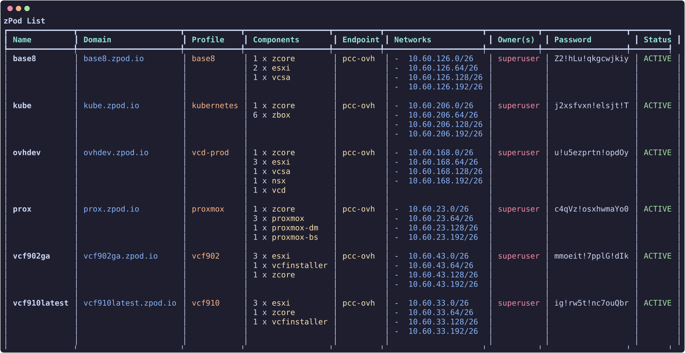

# zPods

zPods are the nested environments name in the zPodFactory framework.

## List zPods

``` {data-copy="zcli zpod list"}
❯ zcli zpod list
```



## Create zPods

To create a zPod you will need to provide a few parameters:

- `name`: The name of the zPod (must start with a letter; emoji characters are rejected). Non-superadmin users may be required to prefix names with their username when `ff_restrict_zpod_with_username_prefix` is enabled.
- `profile`: The profile to use (use `zcli profile list`). If `ff_zpod_default_profile` is set, `--profile` can be omitted.
- `endpoint`: The endpoint to deploy onto (use `zcli endpoint list`). If only one endpoint exists, it is selected automatically.

Additional options:

```bash
zcli zpod create <name> -p <profile> -e <endpoint> \
  --description "My lab" \
  --domain custom.domain.lab \   # optional domain override
  --enet <enet_name> \           # optional ENET override
  --wait                         # wait until deploy completes
```

``` {data-copy="zcli zpod create name -p profile -e endpoint"}
❯ zcli zpod create name -p profile -e endpoint
```

For example:

``` {data-copy="zcli zpod create test -p base -e sddc-lab"}
❯ zcli zpod create test -p base -e sddc-lab
```

This will create a zPod with the following attributes:

- `name`: `test` — concatenated with `zpodfactory_default_domain` for the zPod FQDN (`test.zpodfactory.domain`). The core appliance is at `zcore.test.zpodfactory.domain`.

!!! info
    The base domain is configured by the `zpodfactory_default_domain` setting and **should not be changed** after initial setup.
    Check [Settings & feature flags](../admin/feature-flags.md) for more information.

    Every component FQDN is built the same way, `<hostname>.<zPod name>.<default domain>`:

    

- `profile`: `base` — deploys the components defined in that profile. A typical `base` profile includes:

    - `zcore-13.7` (mandatory core: DNS/DHCP, NFS, guest VLAN routing)
    - `esxi-8.0u3i` (Host Id: 11, CPU: 4, Mem: 48GB)
    - `esxi-8.0u3i` (Host Id: 12, CPU: 4, Mem: 48GB)
    - `vcsa-8.0u3i`

!!! info
    The `base` profile is a profile that can ONLY be configured by an Administrator.
    Check [Profiles](../admin/profiles.md) for more information.

- `endpoint`: `sddc-lab` will reference the endpoint to use to deploy the zPod. In this case it will be the `sddc-lab` endpoint that is configured by an Administrator, and should link to the physical environment that will host this zPod nested environment.

!!! info
    The `sddc-lab` endpoint is an endpoint that can ONLY be configured by an Administrator.
    Check [Endpoints](../admin/endpoints.md) for more information.


## Accessing the zPod

Once deployed, inspect connection details with:

``` {data-copy="zcli zpod info test"}
❯ zcli zpod info test
```

This shows networking, component URLs, credentials, and Proxmox UI links where applicable. Use `-j` for JSON or `-f` to pick panels: `b` Basic, `n` Networking, `c` Components, `s` Storage, `d` DNS (for example `-f bnc`).

For vCenter:

- `username`: `administrator@name.zpodfactory.domain`
- `password`: Each zPod has a generated password — fetch it from `zcli zpod list` or `zcli zpod info`.

For other components, use the default administrator account for that product (`root`, `admin`, etc.; `administrator` for VCD). The password is **always** the zPod password.


## Destroy zPods

``` {data-copy="zcli zpod destroy delete name"}
❯ zcli zpod destroy name
```

!!! warning
    This will destroy the zPod and all its components without confirmation, and will not be recoverable.
